# **DACIE** = **D**omain-**A**daptive **C**ompositional **I**nformation **E**xtractor

## Часть 1: Что такое DACIE и зачем он нужен

**DACIE** = **D**omain-**A**daptive **C**ompositional **I**nformation **E**xtractor

### Проблема, которую он решает

У вас есть **техническое задание (ТЗ)** на АСУ ТП — обычный текст на русском языке. Например:

```
2.1. Функциональные требования
Система должна обеспечивать контроль температуры в диапазоне 150-200°C 
с точностью ±1°C. Уровень безопасности SIL 2 согласно IEC 61508.
```

**Компьютер не понимает** этот текст. Ему нужно извлечь **структурированные данные**:

```json
{
  "sensor": {"text": "датчик температуры", "range": "150-200°C"},
  "requirement_safety": {"text": "SIL 2", "standard": "IEC 61508"},
  "requirement_performance": {"text": "точность", "value": "±1°C"}
}
```

**DACIE делает это двумя способами одновременно:**

1. **Символьно** — по ключевым словам из онтологии
2. **Нейронно** — через DeepSeek (AI)

Потом **объединяет** результаты.

---

## Часть 2: Архитектура DACIE

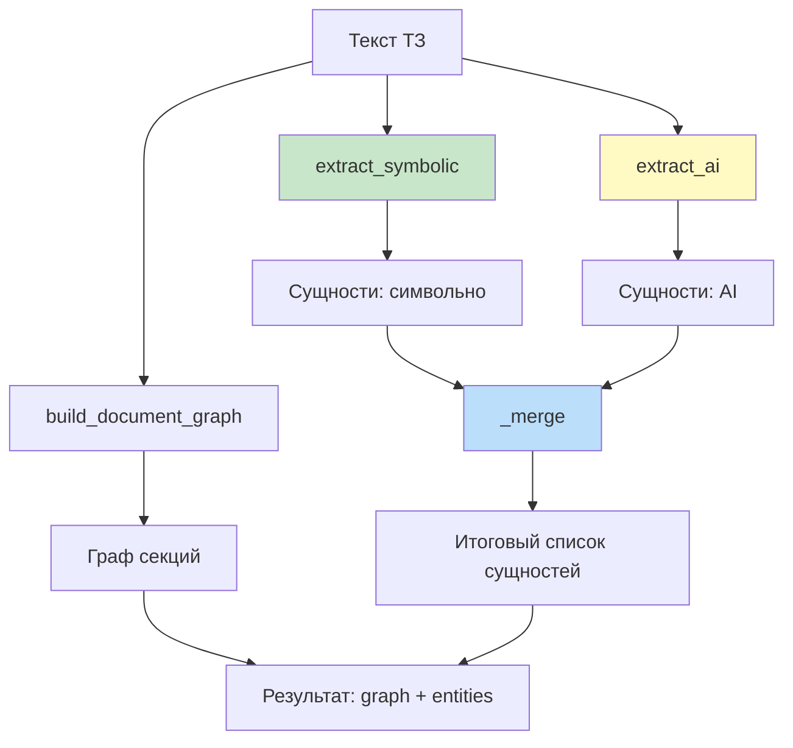

### Ключевая идея: два независимых источника

| Источник | Метод | Плюсы | Минусы |
|----------|-------|-------|--------|
| **Символьный** | Поиск ключевых слов из онтологии | Быстро, детерминированно | Не находит сложные конструкции |
| **AI (DeepSeek)** | LLM анализирует текст | Понимает контекст | Медленно, может ошибаться |

**Объединение** даёт лучшее из двух миров.

---

## Часть 3: Пошаговый разбор кода

### Шаг 3.1: Инициализация — `__init__`

```python
def __init__(self, use_ai: bool = True):
    self.use_ai = use_ai
    self.ontology = self._load_ontology()   # ← загружаем словарь АСУ ТП
    
    self.ai_client = None
    if use_ai:
        try:
            self.ai_client = get_ai_client()   # ← подключаемся к Ollama
            logger.info("AI Service подключён")
        except Exception as e:
            logger.warning(f"AI недоступен: {e}")
            self.use_ai = False   # ← если Ollama не работает — работаем без AI
    
    logger.info(f"DACIE готов: {len(self.ontology['entity_types'])} типов")
```

**Что происходит:**

1. **`use_ai`** — флаг: использовать ли DeepSeek
2. **`_load_ontology()`** — загружает `data/ontology/asutp_ontology.json`:
   ```json
   {
     "concepts": {
       "sensor": {"keywords": ["датчик", "сенсор"], "weight": 1.0},
       "controller": {"keywords": ["контроллер", "плк"]},
       ...
     }
   }
   ```
3. **`get_ai_client()`** — создаёт подключение к Ollama (`http://localhost:11434/v1`)
4. **Fallback** — если AI недоступен, просто работаем символьно

**В ваших логах:**
```
AI Service подключён     ← Ollama работает
DACIE готов: 10 типов    ← онтология загружена
```

---

### Шаг 3.2: Загрузка онтологии — `_load_ontology`

```python
def _load_ontology(self) -> Dict:
    path = Path("data/ontology/asutp_ontology.json")
    if not path.exists():
        raise FileNotFoundError(f"Онтология не найдена: {path}")
    with open(path, 'r', encoding='utf-8') as f:
        return json.load(f)
```

**Просто:** читает JSON-файл с описанием типов сущностей АСУ ТП.

---

### Шаг 3.3: Граф документа — `build_document_graph`

```python
def build_document_graph(self, text: str) -> Dict:
    sections = []
    lines = text.split('\n')
    current = None
    section_id = 0
    
    for line in lines:
        line = line.strip()
        if not line:
            continue
        # Заголовок: "1. ОБЩИЕ ПОЛОЖЕНИЯ" или "2.1. Требования"
        if re.match(r'^\d+(\.\d+)*\.?\s+[А-ЯЁ]', line):
            if current is not None:
                sections.append(current)
            current = {
                'id': section_id,
                'title': line,
                'text': line,
                'level': line.count('.') + 1 if '.' in line[:6] else 1,
            }
            section_id += 1
        elif current is not None:
            current['text'] += '\n' + line
    
    if current is not None:
        sections.append(current)
    
    return {'sections': sections, 'num_sections': len(sections)}
```

**Что делает:**

1. **Разбивает ТЗ на секции** по заголовкам (`1.`, `1.1.`, `2.3.1.` и т.д.)
2. **Каждая секция** — словарь `{id, title, text, level}`
3. **Возвращает** `{'sections': [...], 'num_sections': N}`

**Пример:**

Входной текст:
```
1. ОБЩИЕ ПОЛОЖЕНИЯ
1.1. Назначение
АСУ ТП для контроля температуры.

2. ТРЕБОВАНИЯ
2.1. Функциональные
Система должна...
```

Результат:
```python
{
  'sections': [
    {'id': 0, 'title': '1. ОБЩИЕ ПОЛОЖЕНИЯ', 'level': 1, 'text': '...'},
    {'id': 1, 'title': '1.1. Назначение', 'level': 2, 'text': '...'},
    {'id': 2, 'title': '2. ТРЕБОВАНИЯ', 'level': 1, 'text': '...'},
    {'id': 3, 'title': '2.1. Функциональные', 'level': 2, 'text': '...'},
  ],
  'num_sections': 4
}
```

**Важно:** этот граф **пока не используется** в других методах (кроме вывода). Он может быть использован позже для:
- Сохранения контекста секций
- Отслеживания источника каждой сущности
- Визуализации структуры ТЗ

---

### Шаг 3.4: Символьное извлечение — `extract_symbolic`

```python
def extract_symbolic(self, text: str) -> List[Dict]:
    entities = []
    text_lower = text.lower()
    for concept, rules in self.ontology['concepts'].items():
        for keyword in rules['keywords']:
            if keyword.lower() in text_lower:
                entities.append({
                    'text': keyword,
                    'type': concept,
                    'confidence': 0.75,
                    'source': 'symbolic',
                })
                break   # ← только одно совпадение на концепт
    return entities
```

**Что делает:**

1. **Для каждого концепта** в онтологии (`sensor`, `controller`, ...)
2. **Проверяет** наличие его ключевых слов в тексте (без учёта регистра)
3. **Если найдено** — добавляет сущность с уверенностью 0.75
4. **`break`** — только первое совпадение (чтобы не дублировать)

**Пример:**

Текст:
```
Система должна контролировать температуру. Датчик PT100. 
Контроллер Siemens. SIL 2.
```

Онтология:
```json
{
  "sensor": {"keywords": ["датчик", "сенсор"]},
  "controller": {"keywords": ["контроллер", "плк"]},
  "requirement_safety": {"keywords": ["sil", "безопасность"]}
}
```

Результат:
```python
[
  {'text': 'датчик', 'type': 'sensor', 'confidence': 0.75, 'source': 'symbolic'},
  {'text': 'контроллер', 'type': 'controller', 'confidence': 0.75, 'source': 'symbolic'},
  {'text': 'sil', 'type': 'requirement_safety', 'confidence': 0.75, 'source': 'symbolic'},
]
```

**Плюсы:** быстро, детерминированно  
**Минусы:** не находит «датчик температуры 150-200°C» как единое целое

---

### Шаг 3.5: AI-извлечение — `extract_ai`

```python
def extract_ai(self, text: str) -> List[Dict]:
    if not self.use_ai or not self.ai_client:
        return []    # ← если AI отключён — сразу выходим
    
    from src.ai_service.prompts.entity_extraction import (
        ENTITY_EXTRACTION_SYSTEM, build_entity_extraction_prompt
    )
    
    try:
        response = self.ai_client.generate(
            prompt=build_entity_extraction_prompt(text),
            system_prompt=ENTITY_EXTRACTION_SYSTEM,
            temperature=0.1,
            max_tokens=4096,
        )
        return self._parse_json(response)
    except Exception as e:
        logger.error(f"AI ошибка: {e}")
        return []
```

**Что происходит:**

1. **Проверка:** если AI отключён — возвращаем пустой список
2. **Формируется промпт** через `build_entity_extraction_prompt(text)`:
   ```
   Извлеки сущности из фрагмента ТЗ АСУ ТП:
   "..."
   Типы: sensor, controller, ...
   Ответ — ТОЛЬКО JSON:
   {"entities": [{"text": "...", "type": "...", "confidence": 0.95}]}
   ```
3. **Системный промпт:** «Ты — эксперт по АСУ ТП. Отвечай ТОЛЬКО JSON.»
4. **Отправка в DeepSeek** через Ollama
5. **`max_tokens=4096`** — важно! Если меньше, JSON обрезается
6. **Парсинг** через `_parse_json(response)`

**Пример ответа DeepSeek:**

```
```json
{
  "entities": [
    {
      "text": "температура 150-200°C",
      "type": "sensor",
      "confidence": 0.95,
      "attributes": {"range": "150-200°C"}
    },
    {
      "text": "SIL 2",
      "type": "requirement_safety",
      "confidence": 0.95,
      "attributes": {"standard": "IEC 61508"}
    }
  ]
}
```
```

**Плюсы:** понимает контекст, извлекает сложные сущности  
**Минусы:** медленно (5-15 сек), может обрезаться JSON

---

### Шаг 3.6: Парсинг JSON — `_parse_json`

```python
def _parse_json(self, response: str) -> List[Dict]:
    try:
        start = response.find('{')
        end = response.rfind('}') + 1
        if start == -1 or end == 0:
            return []
        data = json.loads(response[start:end])
        for e in data.get('entities', []):
            e['source'] = 'ai'    # ← помечаем источник
        return data.get('entities', [])
    except json.JSONDecodeError:
        return []
```

**Что делает:**

1. **Находит** первый `{` и последний `}` в ответе — это JSON-границы
2. **Парсит** найденный фрагмент
3. **Помечает** каждую сущность `source='ai'`
4. **При ошибке** — возвращает `[]`

**Проблема:** если JSON обрезан (`max_tokens` мал) — `json.JSONDecodeError` и результат `[]`.

**Именно это и было в вашем случае:** 2048 токенов → JSON обрезался → AI: 0.

**Решение:** `max_tokens=4096` (как сейчас) → JSON полный → AI: 12.

---

### Шаг 3.7: Основной метод — `process`

```python
def process(self, text: str) -> Dict[str, Any]:
    logger.info("DACIE: обработка")
    
    # 1. Граф документа (структура ТЗ)
    graph = self.build_document_graph(text)
    
    # 2. Символьное извлечение
    symbolic = self.extract_symbolic(text)
    logger.info(f"Символьных: {len(symbolic)}")
    
    # 3. AI извлечение
    ai_entities = []
    if self.use_ai:
        ai_entities = self.extract_ai(text)
        logger.info(f"AI: {len(ai_entities)}")
    
    # 4. Объединение
    merged = self._merge(symbolic, ai_entities)
    logger.info(f"Итого: {len(merged)}")
    
    return {'graph': graph, 'entities': merged}
```

**Что происходит:**

1. **Граф** — структура секций
2. **Символьные сущности** — быстрые, 8 штук
3. **AI-сущности** — умные, 12 штук
4. **Merge** — объединение без дублей

**В ваших логах:**
```
DACIE: обработка
Символьных: 8
AI: 12
Итого: 20
```

---

### Шаг 3.8: Объединение — `_merge`

```python
def _merge(self, symbolic: List, ai: List) -> List:
    merged = {}
    for e in symbolic + ai:
        key = (e['text'].lower(), e['type'])   # ← уникальный ключ
        if key not in merged or \
           e.get('confidence', 0) > merged[key].get('confidence', 0):
            merged[key] = e   # ← берём с большей уверенностью
    
    return list(merged.values())
```

**Логика:**

- **Ключ:** `(текст, тип)` в нижнем регистре
- **Если дубликат:** оставляем тот, у которого **больше `confidence`**
- **Результат:** список уникальных сущностей

**Пример слияния:**

| Источник | Текст | Тип | Confidence |
|----------|-------|-----|------------|
| symbolic | `sil` | requirement_safety | 0.75 |
| ai | `SIL 2` | requirement_safety | 0.95 |

**Ключи разные** (`sil` ≠ `sil 2`) — обе остаются.

Если бы были одинаковыми — осталась бы `SIL 2` (confidence 0.95).

---

## Часть 4: Как DACIE встроен в проект

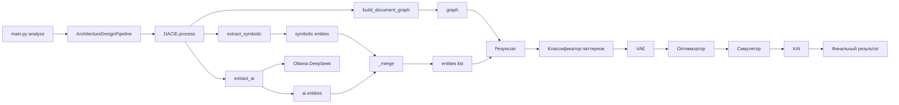

### Поток данных

1. **Пользователь** загружает ТЗ
2. **DACIE** извлекает сущности (символьные + AI)
3. **Классификатор** определяет архитектурный паттерн
4. **VAE** генерирует варианты архитектур
5. **Оптимизатор** размещает компоненты
6. **Симулятор** оценивает качество
7. **XAI** объясняет решение

**DACIE — это «глаза» системы:** он «читает» ТЗ и превращает текст в структуру.

---

## Часть 5: Что улучшить в текущей версии

### Проблема 1: `build_document_graph` не используется

Сейчас граф создаётся, но **не влияет** на другие методы. Он только возвращается в `process`.

**Улучшение:**

```python
def extract_ai_by_sections(self, graph: Dict) -> List[Dict]:
    """Извлекаем AI-сущности по секциям, а не по всему тексту."""
    all_entities = []
    for section in graph['sections']:
        # Для каждой секции — свой AI-запрос
        entities = self.extract_ai(section['text'])
        for e in entities:
            e['section_id'] = section['id']
        all_entities.extend(entities)
    return all_entities
```

**Плюсы:**
- Меньше `max_tokens` на запрос
- AI лучше работает с короткими текстами
- Трассировка: откуда пришла сущность

---

### Проблема 2: `_parse_json` не обрабатывает markdown

Ваш тест показал, что DeepSeek возвращает ```` ```json ... ``` ````. Текущий `_parse_json` ищет `{` — это работает, **но** лучше явно обрабатывать:

```python
def _parse_json(self, response: str) -> List[Dict]:
    response = response.strip()
    
    # Удалить markdown
    if '```json' in response:
        start_md = response.find('```json') + 7
        end_md = response.find('```', start_md)
        if end_md > start_md:
            response = response[start_md:end_md].strip()
    elif '```' in response:
        start_md = response.find('```') + 3
        end_md = response.find('```', start_md)
        if end_md > start_md:
            response = response[start_md:end_md].strip()
    
    # Найти JSON
    start = response.find('{')
    end = response.rfind('}') + 1
    if start == -1 or end == 0:
        return []
    
    try:
        data = json.loads(response[start:end])
        for e in data.get('entities', []):
            e['source'] = 'ai'
        return data.get('entities', [])
    except json.JSONDecodeError as e:
        logger.warning(f"JSON ошибка: {e}")
        return []
```

---

### Проблема 3: `_merge` может терять атрибуты

Сейчас `_merge` берёт **целую сущность** с большей уверенностью. Но если у AI-сущности есть `attributes`, а у символической нет — при конфликте атрибуты AI-версии сохранятся. Это нормально.

**Но** если хотите объединять атрибуты:

```python
def _merge(self, symbolic: List, ai: List) -> List:
    merged = {}
    
    for e in symbolic + ai:
        key = (e['text'].lower(), e['type'])
        
        if key not in merged:
            merged[key] = e.copy()
        else:
            existing = merged[key]
            
            # Оставляем большую confidence
            if e.get('confidence', 0) > existing.get('confidence', 0):
                merged[key] = e.copy()
            
            # Объединяем attributes
            existing_attrs = existing.get('attributes', {})
            new_attrs = e.get('attributes', {})
            merged[key]['attributes'] = {**existing_attrs, **new_attrs}
    
    return list(merged.values())
```

---

### Проблема 4: Нет трассировки источника

**Улучшение:** добавить `section_id` к каждой сущности:

```python
def process(self, text: str) -> Dict[str, Any]:
    graph = self.build_document_graph(text)
    
    # Поиск секции для каждой сущности
    def find_section(entity_text):
        for sec in graph['sections']:
            if entity_text.lower() in sec['text'].lower():
                return sec['id']
        return -1
    
    symbolic = self.extract_symbolic(text)
    ai_entities = self.extract_ai(text) if self.use_ai else []
    
    merged = self._merge(symbolic, ai_entities)
    
    # Добавляем section_id
    for e in merged:
        e['section_id'] = find_section(e['text'])
    
    return {'graph': graph, 'entities': merged}
```

---

## Часть 6: Полная диаграмма работы

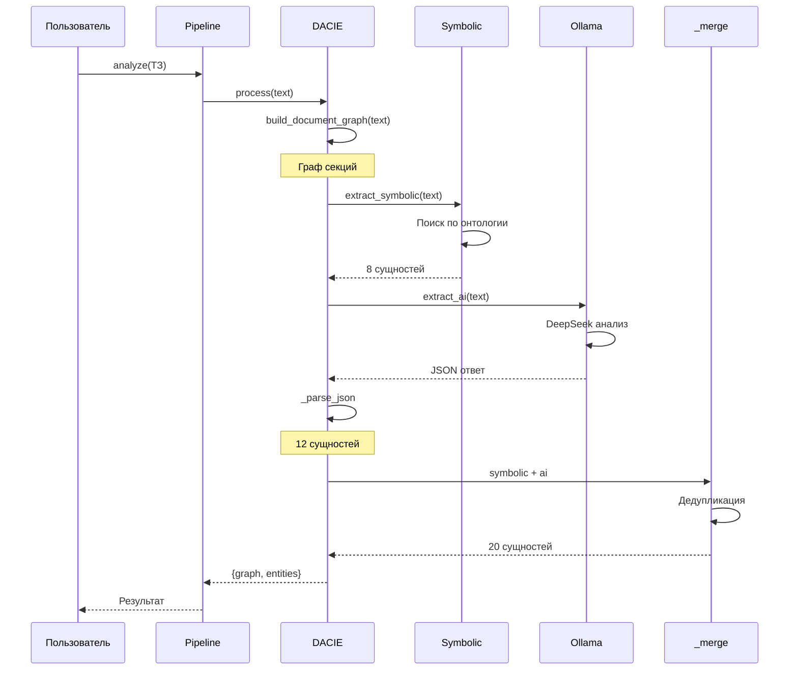

---

## Часть 7: Пример — что происходит с реальным ТЗ

**Входной текст (фрагмент):**
```
2.1. Функциональные требования
Система должна обеспечивать контроль температуры в диапазоне 150-200°C 
с точностью ±1°C.

2.2. Требования безопасности
Система должна обеспечивать уровень безопасности SIL 2 согласно IEC 61508.
```

### Шаг 1: `build_document_graph`

```python
{
  'sections': [
    {'id': 0, 'title': '2.1. Функциональные требования', 'level': 2, 
     'text': '2.1. ... контроль температуры...'},
    {'id': 1, 'title': '2.2. Требования безопасности', 'level': 2,
     'text': '2.2. ... SIL 2...'}
  ],
  'num_sections': 2
}
```

### Шаг 2: `extract_symbolic`

Проверка по онтологии:
- `sensor` → «датчик» — **не найдено** (есть «контроль температуры»)
- `requirement_functional` → «должна» — **найдено** ✓
- `requirement_safety` → «sil» — **найдено** ✓
- `requirement_performance` → «точность» — **найдено** ✓

```python
[
  {'text': 'должна', 'type': 'requirement_functional', 'confidence': 0.75},
  {'text': 'sil', 'type': 'requirement_safety', 'confidence': 0.75},
  {'text': 'точность', 'type': 'requirement_performance', 'confidence': 0.75},
]
```

### Шаг 3: `extract_ai` → Ollama DeepSeek

Промпт → DeepSeek → JSON:
```json
{
  "entities": [
    {"text": "температура 150-200°C", "type": "sensor", "confidence": 0.95},
    {"text": "SIL 2", "type": "requirement_safety", "confidence": 0.95},
    {"text": "IEC 61508", "type": "interface", "confidence": 0.9},
    {"text": "точность ±1°C", "type": "requirement_performance", "confidence": 0.9}
  ]
}
```

### Шаг 4: `_merge`

| Текст | Тип | Источник | Confidence | Оставить? |
|-------|-----|----------|------------|-----------|
| должна | functional | symbolic | 0.75 | ✅ |
| sil | safety | symbolic | 0.75 | ✅ |
| точность | performance | symbolic | 0.75 | ✅ |
| температура 150-200°C | sensor | ai | 0.95 | ✅ |
| SIL 2 | safety | ai | 0.95 | ✅ (разный текст с «sil») |
| IEC 61508 | interface | ai | 0.9 | ✅ |
| точность ±1°C | performance | ai | 0.9 | ✅ |

**Итого: 7 уникальных сущностей.**

---

## Итог: как работает DACIE

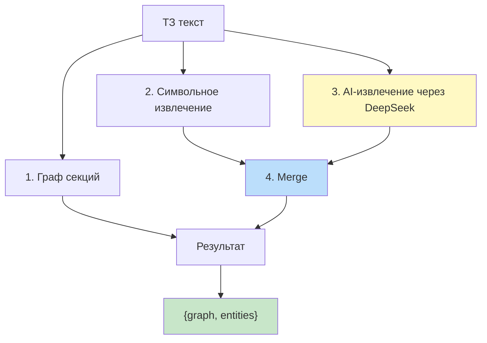

### Ключевые идеи

1. **Два независимых канала** — символьно (быстро) + AI (умно)
2. **Fallback** — если AI не работает, остаётся символика
3. **Merge** — оставляем лучшее из двух
4. **Граф документа** — структура ТЗ (пока используется только для вывода)
5. **`max_tokens=4096`** — критично для полного JSON

### Что даёт система

- **8-12 сущностей** от символики
- **10-15 сущностей** от AI
- **15-25 уникальных** после merge
- **Время:** 5-15 секунд (AI) + 0.1 секунды (символика)


**DACIE — это фундамент системы: без качественного извлечения сущностей все последующие этапы (классификация, генерация, оптимизация) работают на «грязных» данных.**

# Порядок сборки проекта

## Часть 1: Порядок «сборки» — что происходит при запуске

Когда вы выполняете:

```bash
poetry run python -m src.main analyze
```

Python выполняет следующие шаги:

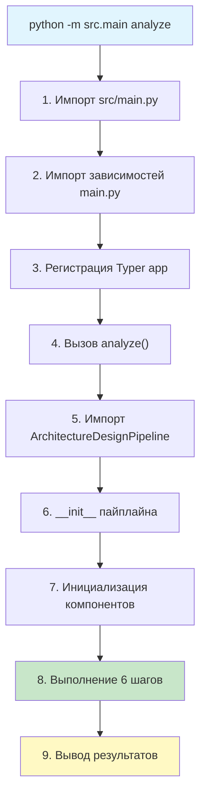

---

## Часть 2: Пошаговая трассировка

### Шаг 1: `python -m src.main analyze`

Что делает Python:
1. Находит `src/main.py`
2. **Импортирует** его (выполняет весь код на уровне модуля)
3. Ищет `if __name__ == "__main__": app()` — вызывает `app()`
4. Typer разбирает `analyze` как команду

---

### Шаг 2: Импорт `src/main.py` — что подгружается

**Порядок импортов** (сверху вниз):

```python
# === 1. Стандартные библиотеки ===
import sys
from pathlib import Path
import typer
from rich.console import Console
from rich.table import Table
from rich.panel import Panel
from loguru import logger

# === 2. Настройка логирования (выполняется сразу!) ===
logger.remove()
logger.add(sys.stdout, level="INFO", ...)
logger.add("logs/app.log", rotation="10 MB", level="DEBUG")

# === 3. Создание Typer app ===
console = Console()
app = typer.Typer(help="СППР для проектирования архитектуры ПО АСУ ТП")

# === 4. Регистрация команд ===
@app.command()
def check(): ...

@app.command()
def analyze(...): ...

@app.command()
def ui(): ...

@app.command()
def serve(): ...

# === 5. Точка входа ===
if __name__ == "__main__":
    app()
```

**Важно:** на этом этапе **пайплайн ещё не создан** — только зарегистрированы команды.

**В ваших логах это НЕ видно**, потому что импорты `main.py` тихие.

---

### Шаг 3: Вызов `analyze()`

Typer передаёт управление функции `analyze`. **Теперь начинается реальная работа.**

```python
@app.command()
def analyze(input_file, team_size, budget, ...):
    # 1. Проверка файла
    if not input_file.exists():
        console.print(f"[red]❌ Файл не найден[/red]")
        raise typer.Exit(1)
    
    # 2. Чтение ТЗ
    with open(input_file, 'r', encoding='utf-8') as f:
        tz_text = f.read()
    
    # 3. Контекст
    context = {...}
    
    # 4. 🔥 СОЗДАНИЕ ПАЙПЛАЙНА
    from src.pipeline.orchestrator import ArchitectureDesignPipeline
    pipeline = ArchitectureDesignPipeline(use_ai=not no_ai)
    
    # 5. 🔥 ЗАПУСК
    result = pipeline.run(tz_text, context, verbose=True)
    
    # 6. Вывод
    _print_entities(result.requirements['entities'])
    _print_patterns(result.patterns)
    _print_quality(result.quality_assessment)
```

**В ваших логах:**
```
╭───────────────────╮
│ 🚀 Запуск анализа │     ← начало analyze()
╰───────────────────╯
📄 Документ: 1423 символов   ← чтение ТЗ
```

---

### Шаг 4: Импорт `ArchitectureDesignPipeline`

Когда выполняется:

```python
from src.pipeline.orchestrator import ArchitectureDesignPipeline
```

Python **загружает** `src/pipeline/orchestrator.py`. Что при этом **импортируется**:

```python
# === src/pipeline/orchestrator.py ===
import time
from dataclasses import dataclass, field
from typing import Dict, List, Any
from loguru import logger

# 🔥 Каждый импорт тянет свои зависимости
from src.ml.dacie.entity_extractor import DACIE
from src.ml.classifier.xgboost_model import PatternClassifier
from src.ml.generator.vae_generator import ArchitectureVAE
from src.ml.optimizer.optimizer import TopologyOptimizer, optimize_placement
from src.ml.evaluator.simulator import evaluate_architecture
from src.ml.xai.shap_analyzer import ArchitectureExplainer
```

**Цепочка импортов:**

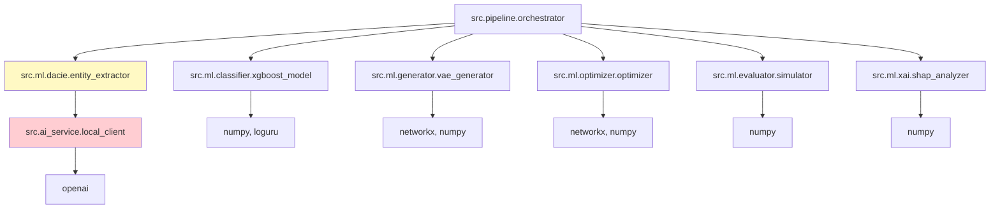

**Ключевое:** импорт `DACIE` тянет `src.ai_service.local_client`, который при **создании** делает HTTP-запрос к Ollama.

Но **создание** происходит только в `__init__` — импорт сам по себе не подключается к Ollama.

---

### Шаг 5: `ArchitectureDesignPipeline.__init__`

```python
def __init__(self, use_ai: bool = True):
    logger.info("=" * 60)
    logger.info("Инициализация конвейера")     # ← лог
    logger.info("=" * 60)
    
    # 1. DACIE (внутри — подключение к Ollama)
    self.dacie = DACIE(use_ai=use_ai)
    
    # 2. Классификатор
    self.classifier = PatternClassifier()
    
    # 3. VAE
    self.vae = ArchitectureVAE()
    
    # 4. Оптимизатор
    self.topology_optimizer = TopologyOptimizer()
    
    # 5. XAI
    self.explainer = ArchitectureExplainer(self.classifier)
    
    logger.info("Все компоненты готовы")
```

**Порядок инициализации:**

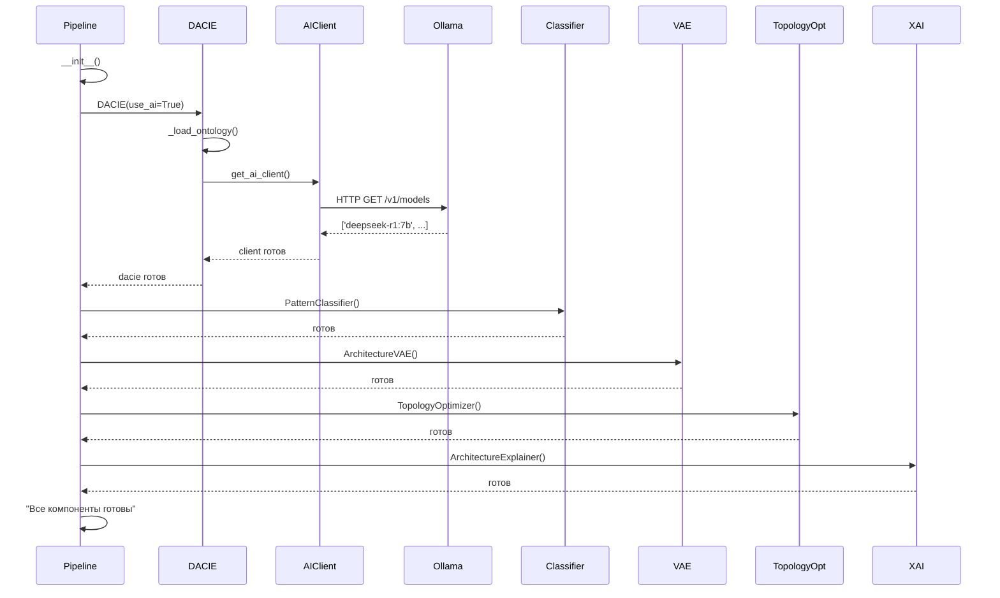

**В ваших логах:**
```
Инициализация конвейера
Доступные модели: ['deepseek-r1:1.5b', 'deepseek-r1:7b']   ← Ollama
AIClient готов: http://localhost:11434/v1
AI Service подключён                                       ← DACIE
DACIE готов: 10 типов
PatternClassifier готов
ArchitectureVAE готов
TopologyOptimizer готов
ArchitectureExplainer готов
Все компоненты готовы
```

---

### Шаг 6: `pipeline.run()` — пошаговое выполнение

```python
def run(self, document_text, context, verbose=True):
    result = PipelineResult()
    timings = {}
    total_start = time.time()
    
    # === ШАГ 1 ===
    dacie_out = self.dacie.process(document_text)
    
    # === ШАГ 2 ===
    patterns = self.classifier.classify(...)
    
    # === ШАГ 3 ===
    architectures = self.vae.generate(...)
    optimized_graph = self.topology_optimizer.optimize(...)
    
    # === ШАГ 4 ===
    placement = optimize_placement(...)
    
    # === ШАГ 5 ===
    quality = evaluate_architecture(...)
    
    # === ШАГ 6 ===
    explanation = self.explainer.explain(...)
    
    return result
```

---

## Часть 3: Детализация каждого шага

### ШАГ 1: `DACIE.process()` — NLP-анализ

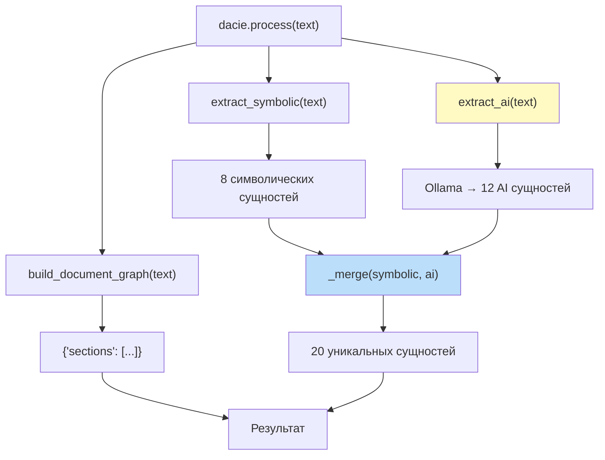

**Что вы видите в логах:**
```
Шаг 1/6: NLP-анализ (DACIE)
DACIE: обработка
Символьных: 8
AI: 12                 ← Ollama
Итого: 20
  ✅ 12.45с | сущностей: 20
```

**Время:** 5-15 секунд (AI-вызов).

---

### ШАГ 2: `classifier.classify()` — классификация

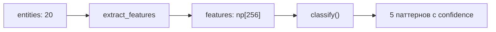

**Что происходит:**

1. **`extract_features`** — считает статистику:
   - `features[0]` = 20 (всего сущностей)
   - `features[1]` = 5 (функциональных)
   - `features[2]` = 3 (safety)
   - `features[64]` = team_size
   - ...

2. **`classify`** — эвристики:
   - `layered`: 0.7 + 0.1 × SIL
   - `event_driven`: 0.85 если real_time
   - ...

**Что в логах:**
```
Шаг 2/6: Классификация паттернов
  ✅ 0.02с | топ: layered
```

**Время:** 0.02 секунды (мгновенно).

---

### ШАГ 3: `vae.generate()` + `topology_optimizer.optimize()` — граф

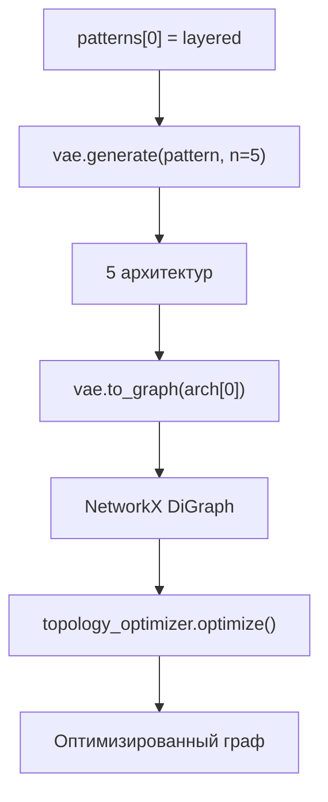

**Что происходит:**

1. **VAE** создаёт 5 архитектур на основе паттерна `layered`:
   ```python
   {
     'pattern': 'layered',
     'components': [
       {'id': 'sensor_adapter', 'latency': 5, ...},
       {'id': 'controller', 'latency': 10, ...},
       {'id': 'historian', 'latency': 15, ...},
       {'id': 'hmi', 'latency': 20, ...},
       {'id': 'business_logic', 'latency': 10, ...},
     ]
   }
   ```

2. **`to_graph`** — превращает в граф:
   ```
   sensor_adapter → controller → historian → hmi
                                     ↓
                               business_logic
   ```

3. **`optimize`** — добавляет связи для связности.

**В логах:**
```
Шаг 3/6: Графовое моделирование
Сгенерировано 5 архитектур
Оптимизация: 5 узлов, 4 рёбер
  ✅ 0.15с | узлов: 5
```

---

### ШАГ 4: `optimize_placement()` — размещение

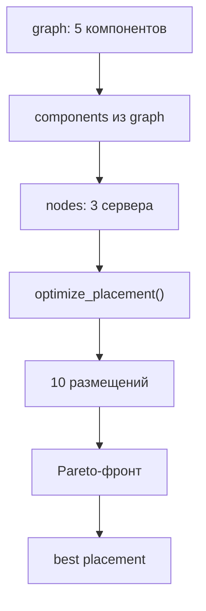

**Что происходит:**

1. **Компоненты** из графа:
   ```python
   [
     {'id': 'sensor_adapter', 'latency': 5.0},
     {'id': 'controller', 'latency': 10.0},
     ...
   ]
   ```

2. **Узлы** — 3 сервера:
   ```python
   [
     {'id': 'server_1', 'cost_rub': 500000, 'latency_ms': 5},
     {'id': 'server_2', 'cost_rub': 800000, 'latency_ms': 3},
     {'id': 'server_3', 'cost_rub': 1500000, 'latency_ms': 2},
   ]
   ```

3. **Оптимизация** — случайные размещения:
   ```
   Попытка 1: [sensor→srv1, controller→srv2, ...]
   Попытка 2: [sensor→srv2, controller→srv1, ...]
   ...
   ```

4. **Сортировка** по взвешенной сумме:
   - 0.4 × latency/100
   - 0.3 × cost/1e6
   - 0.3 × unreliability

**В логах:**
```
Шаг 4/6: Оптимизация размещения
Размещение: 5 × 3
  ✅ 0.08с | решений: 10
```

---

### ШАГ 5: `evaluate_architecture()` — симуляция

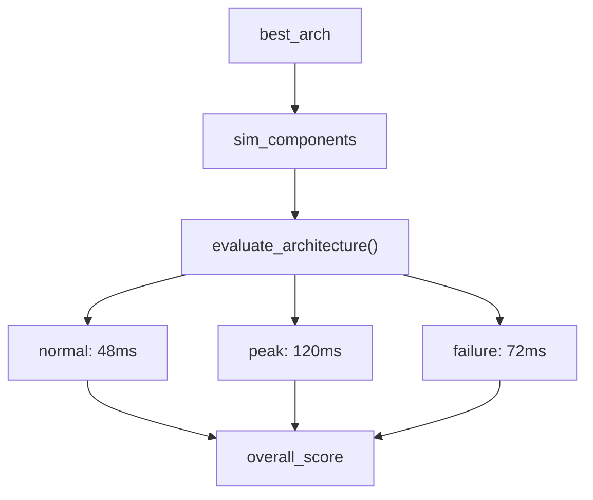

**Что происходит:**

1. **Сборка компонентов для симулятора:**
   ```python
   [
     {'id': 'sensor_adapter', 'capacity': 10, 'processing_time': 0.005},
     ...
   ]
   ```

2. **Симуляция 3 сценариев:**
   - `normal` (load=10) → p95 = 48 мс
   - `peak` (load=25) → p95 = 120 мс
   - `failure` (load=15) → p95 = 72 мс

3. **Score:**
   ```
   normal:  0.3 × 1/(1+0.048) = 0.286
   peak:    0.4 × 1/(1+0.120) = 0.357
   failure: 0.3 × 1/(1+0.072) = 0.280
   Итого:   ≈ 0.923
   ```

**В логах:**
```
Шаг 5/6: Симуляция качества
  ✅ 0.03с | score: 0.8775
```

---

### ШАГ 6: `explainer.explain()` — интерпретация

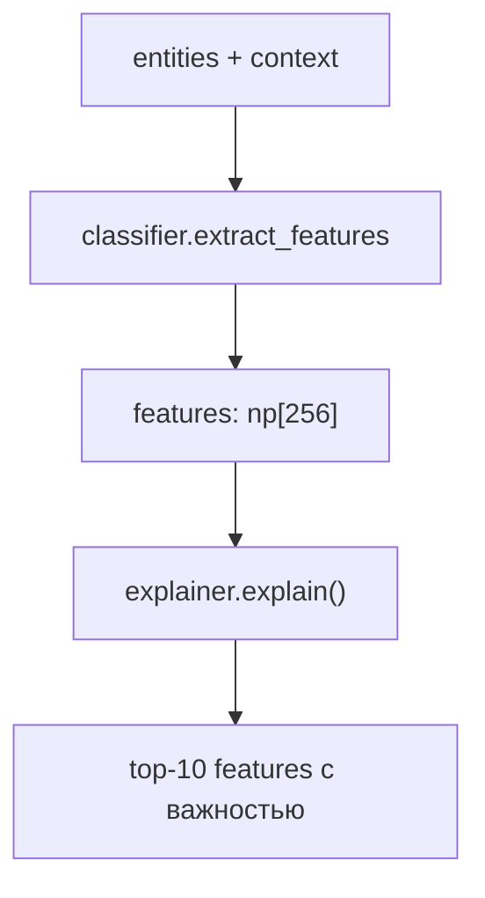

**Что происходит:**

1. **Признаки** — те же, что для классификатора.
2. **Объяснитель** — находит топ-10 по абсолютному значению:
   ```python
   {
     'top_features': [
       {'name': 'num_safety', 'value': 3.0, 'importance': 3.0},
       {'name': 'real_time', 'value': 1.0, 'importance': 1.0},
       ...
     ],
     'method': 'fallback'
   }
   ```

**В логах:**
```
Шаг 6/6: Интерпретация
  ✅ 0.01с
```

---

### Шаг 7: Вывод результатов

```python
# main.py после pipeline.run()
console.print("\n📋 Сущности:")
_print_entities(result.requirements['entities'])

console.print("\n🏗️ Паттерны:")
_print_patterns(result.patterns)

console.print("\n📊 Качество:")
_print_quality(result.quality_assessment)

console.print(f"\n⏱️ Всего: {result.timings['total']:.2f}с")
```

**Что вы видите:**
```
📋 Сущности:
┏━━━━━━━━━━━━━━━━━━━━━━━━━┳━━━━━━━━━━━━━━━┳━━━━━━━━━━┓
┃ Тип                     ┃ Текст         ┃ Источник ┃
┡━━━━━━━━━━━━━━━━━━━━━━━━━╇━━━━━━━━━━━━━━━╇━━━━━━━━━━┩
│ controller              │ контроллер    │ symbolic │
│ requirement_safety      │ SIL 2         │ ai       │
...
```

---

## Часть 4: Полная блок-схема

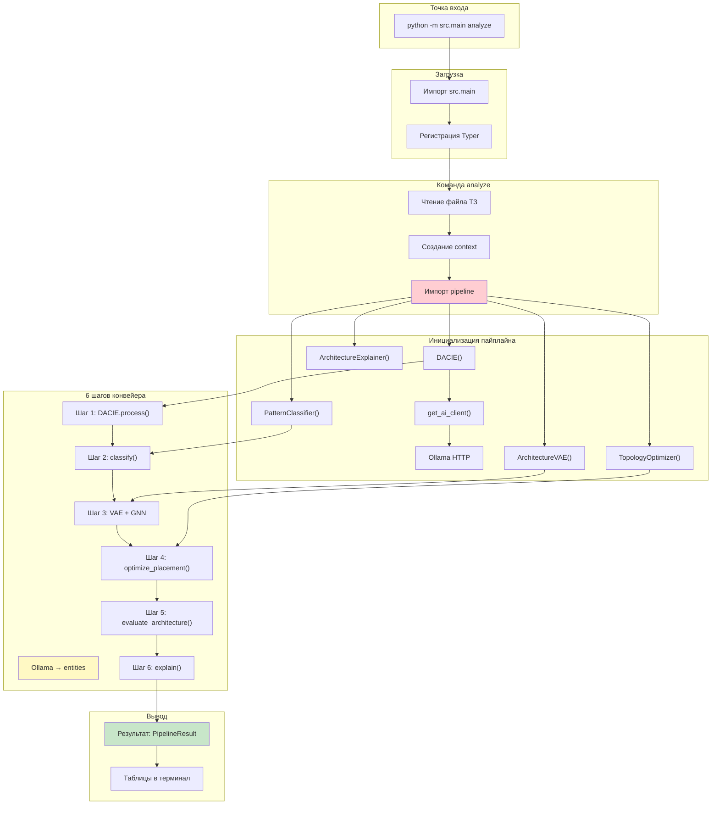

---

## Часть 5: Временная шкала выполнения

```
t=0.00s │ 🚀 Запуск analyze()
        │
t=0.01s │ 📄 Документ: 1423 символов
        │
t=0.02s │ ============================================================
        │ Инициализация конвейера
        │ ============================================================
        │
t=0.10s │ Доступные модели: ['deepseek-r1:1.5b', 'deepseek-r1:7b']
        │ AIClient готов: http://localhost:11434/v1
        │ AI Service подключён
        │ DACIE готов: 10 типов
        │ PatternClassifier готов
        │ ArchitectureVAE готов
        │ TopologyOptimizer готов
        │ ArchitectureExplainer готов
        │ Все компоненты готовы
        │
t=0.11s │ Шаг 1/6: NLP-анализ (DACIE)
        │ DACIE: обработка
        │ Символьных: 8
        │
t=5.00s │ AI: 12       ← Ollama отвечает (5 сек)
        │ Итого: 20
        │   ✅ 4.89с | сущностей: 20
        │
t=5.01s │ Шаг 2/6: Классификация паттернов
        │   ✅ 0.02с | топ: layered
        │
t=5.03s │ Шаг 3/6: Графовое моделирование
        │ Сгенерировано 5 архитектур
        │ Оптимизация: 5 узлов, 4 рёбер
        │   ✅ 0.15с | узлов: 5
        │
t=5.18s │ Шаг 4/6: Оптимизация размещения
        │ Размещение: 5 × 3
        │   ✅ 0.08с | решений: 10
        │
t=5.26s │ Шаг 5/6: Симуляция качества
        │   ✅ 0.03с | score: 0.8775
        │
t=5.29s │ Шаг 6/6: Интерпретация
        │   ✅ 0.01с
        │
t=5.30s │ ============================================================
        │ ✅ Конвейер завершён за 5.30с
        │ ============================================================
        │
t=5.31s │ 📋 Сущности: [таблица]
        │ 🏗️ Паттерны: [таблица]
        │ 📊 Качество: [таблица]
        │ ⏱️ Всего: 5.30с
        │
t=5.32s │ ✅ Готово
```

**Бутылочное горлышко:** Шаг 1 (5 секунд) — из-за AI. Остальные 0.3 секунды.

---

## Часть 6: Что происходит при повторном запуске

При **повторном** запуске:

```
t=0.00s │ 🚀 Запуск analyze()
        │
t=0.10s │ Инициализация ...
        │
t=0.11s │ Шаг 1/6: NLP-анализ
        │ DACIE: обработка
        │ Символьных: 8
        │
t=0.11s │ AI: 12       ← КЭШ! Мгновенно
        │ Итого: 20
        │   ✅ 0.00с | сущностей: 20   ← мгновенно
```

**Причина:** `AIClient` кэширует ответы в `models/ai_server/cache/`. Если промпт тот же — ответ из кэша.

**Чтобы заставить AI работать заново:**
```bash
rm -rf models/ai_server/cache/*
```

---

## Часть 7: Аналогия для понимания

Представьте **конвейер на заводе**:

| Этап | В проекте | Аналогия |
|------|-----------|----------|
| **1. Загрузка** | `python -m src.main` | Разогрев станков |
| **2. Инициализация** | `__init__()` | Настройка параметров |
| **3. Шаг 1** | DACIE | «Прочитать» чертёж |
| **4. Шаг 2** | Классификатор | «Понять», что за деталь |
| **5. Шаг 3** | VAE + GNN | «Нарисовать» эскиз |
| **6. Шаг 4** | Оптимизатор | «Распределить» по станкам |
| **7. Шаг 5** | Симулятор | «Проверить» качество |
| **8. Шаг 6** | XAI | «Объяснить» решение |
| **9. Вывод** | Таблицы | Готовый продукт |

---

## Часть 8: Диаграмма зависимостей файлов

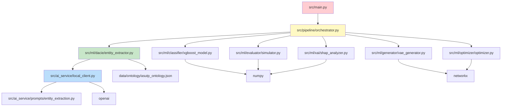

**Порядок загрузки при `import src.pipeline.orchestrator`:**

1. `src.pipeline.orchestrator` (сам файл)
2. `src.ml.dacie.entity_extractor` (из `from src.ml.dacie...`)
3. `src.ai_service.local_client` (из `from src.ai_service...`)
4. `openai` (внешняя библиотека)
5. `src.ml.classifier.xgboost_model`
6. `src.ml.generator.vae_generator`
7. `src.ml.optimizer.optimizer`
8. `src.ml.evaluator.simulator`
9. `src.ml.xai.shap_analyzer`

**После импорта — все классы доступны** для использования в `__init__` пайплайна.

---

## Итог: главное

### Что происходит при запуске

```
1. Импорт main.py (0.01с)
2. Вызов analyze() (0.01с)
3. Импорт pipeline + всех модулей (0.05с)
4. Создание компонентов (0.05с) ← подключение к Ollama
5. Шаг 1: DACIE → Ollama (5-15с) ← БУТЫЛОЧНОЕ ГОРЛЫШКО
6. Шаг 2-6: остальные ML (0.2с)
7. Вывод (0.01с)
```

### Файлы и когда они загружаются

| Файл | Когда загружается | Что делает |
|------|-------------------|------------|
| `src/main.py` | `python -m src.main` | Регистрирует команды |
| `src/pipeline/orchestrator.py` | `from src.pipeline...` в `analyze()` | Создаёт пайплайн |
| `src/ml/dacie/entity_extractor.py` | Импорт пайплайна | NLP-анализ |
| `src/ai_service/local_client.py` | Импорт DACIE | Подключение к Ollama |
| `src/ml/classifier/...` | Импорт пайплайна | Классификация |
| `src/ml/generator/...` | Импорт пайплайна | Генерация архитектур |
| `src/ml/optimizer/...` | Импорт пайплайна | Оптимизация |
| `src/ml/evaluator/...` | Импорт пайплайна | Симуляция |
| `src/ml/xai/...` | Импорт пайплайна | Интерпретация |

### Ключевые точки

- **Ollama** подключается в `DACIE.__init__` (только если `use_ai=True`)
- **Максимальная задержка** — в Шаге 1 (AI-вызов)
- **Повторный запуск** — мгновенно из-за кэша
- **Пайплайн** — это «мозг», а `main.py` — «пульт управления»