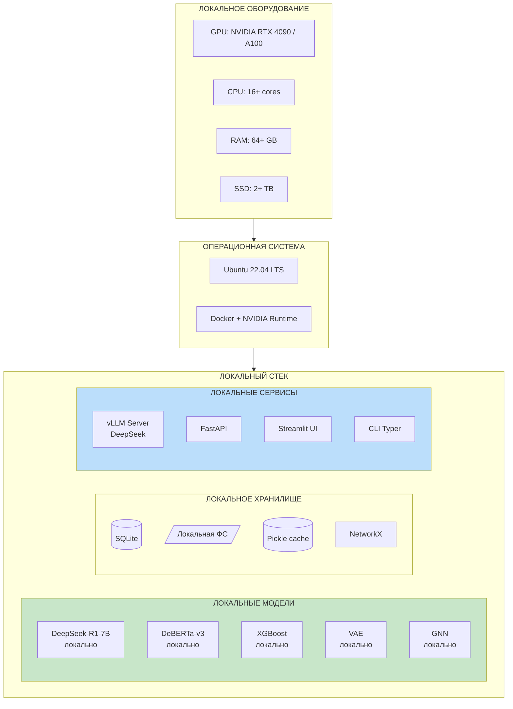

# ПОЛНОЕ РУКОВОДСТВО: ЛОКАЛЬНЫЙ ПРОЕКТ С DEEPSEEK

## Система поддержки принятия решений для проектирования архитектуры ПО АСУ ТП

## с полностью локальной языковой моделью DeepSeek

---

## 1. КОНЦЕПЦИЯ ПОЛНОСТЬЮ ЛОКАЛЬНОГО ПРОЕКТА

### 1.1. Принципы

**"Всё локально — никаких облаков, никаких утечек данных"**

```python
LOCAL_PRINCIPLES = {
    'privacy': 'Все данные (ТЗ, модели, результаты) остаются на вашем оборудовании',
    'determinism': '100% воспроизводимость результатов',
    'no_internet': 'Работает без подключения к интернету после установки',
    'full_control': 'Полный контроль над версиями моделей и алгоритмов',
    'enterprise_ready': 'Соответствие требованиям промышленной безопасности',
    'cost_effective': 'Нет платежей за API-вызовы',
}
```

### 1.2. Архитектура полностью локальной системы



---

## 2. ТРЕБОВАНИЯ К ОБОРУДОВАНИЮ

### 2.1. Минимальная конфигурация

```yaml
Минимальная конфигурация (для разработки и тестирования):
  GPU: 
    - NVIDIA RTX 3090 (24 GB VRAM) или
    - NVIDIA RTX 4090 (24 GB VRAM) или
    - NVIDIA A5000 (24 GB VRAM)
  CPU: 16 cores (Intel i7/i9 или AMD Ryzen 7/9)
  RAM: 64 GB DDR4/DDR5
  Storage: 2 TB NVMe SSD
  
  Что помещается:
    ✓ DeepSeek-R1-Distill-Qwen-7B (в 4-bit: ~5 GB VRAM)
    ✓ DeBERTa-v3-base (~0.5 GB VRAM)
    ✓ XGBoost, VAE, GNN (CPU/GPU)
    ✓ Все данные проекта
```

### 2.2. Рекомендуемая конфигурация

```yaml
Рекомендуемая конфигурация (для полноценной работы):
  GPU:
    - NVIDIA A100 40GB или
    - NVIDIA H100 80GB или
    - 2x NVIDIA RTX 4090 (48 GB суммарно)
  CPU: 32 cores
  RAM: 128 GB
  Storage: 4 TB NVMe SSD (RAID 1)
  
  Что помещается:
    ✓ DeepSeek-R1-Distill-Qwen-14B (в 4-bit: ~10 GB VRAM)
    ✓ DeepSeek-R1-Distill-Llama-8B
    ✓ Все остальные модели
    ✓ Большие датасеты ТЗ
```

### 2.3. Production конфигурация

```yaml
Production (для предприятия):
  GPU: 4x NVIDIA A100 80GB
  CPU: 64 cores (2x Xeon Silver/Gold)
  RAM: 256 GB
  Storage: 10 TB NVMe SSD + 50 TB HDD
  
  Что помещается:
    ✓ DeepSeek-R1-Distill-Qwen-32B
    ✓ Полная DeepSeek-V3 (671B MoE, требует ~1.5 TB VRAM)
    ✓ Параллельная обработка сотен ТЗ
```

---

## 3. УСТАНОВКА ОПЕРАЦИОННОЙ СИСТЕМЫ И ДРАЙВЕРОВ

### 3.1. Установка Ubuntu 22.04 LTS

```bash
# Скачать ISO с ubuntu.com
# Создать загрузочную флешку
# Установить с опциями:
#   ✓ Minimal installation
#   ✓ Install third-party software
#   ✓ Download updates during installation

# После установки — обновление
sudo apt update && sudo apt upgrade -y

# Установка базовых утилит
sudo apt install -y \
    build-essential \
    curl \
    wget \
    git \
    vim \
    htop \
    tmux \
    jq \
    unzip \
    software-properties-common \
    ca-certificates \
    gnupg \
    lsb-release \
    pciutils \
    nvtop
```

### 3.2. Установка NVIDIA Driver

```bash
# 1. Проверка GPU
lspci | grep -i nvidia

# 2. Удаление старых драйверов
sudo apt remove --purge '^nvidia-.*' -y
sudo apt autoremove -y

# 3. Добавление PPA
sudo add-apt-repository ppa:graphics-drivers/ppa -y
sudo apt update

# 4. Определение рекомендуемого драйвера
ubuntu-drivers devices

# 5. Установка драйвера (535 — стабильный)
sudo apt install -y nvidia-driver-535

# 6. Перезагрузка
sudo reboot

# 7. Проверка после перезагрузки
nvidia-smi
```

**Ожидаемый вывод:**
```
+-----------------------------------------------------------------------------+
| NVIDIA-SMI 535.129.03   Driver Version: 535.129.03   CUDA Version: 12.2    |
|-------------------------------+----------------------+----------------------+
| GPU  Name        Persistence-M| Bus-Id        Disp.A | Volatile Uncorr. ECC |
| Fan  Temp  Perf  Pwr:Usage/Cap|         Memory-Usage | GPU-Util  Compute M. |
|===============================+======================+======================|
|   0  NVIDIA RTX 4090     Off  | 00000000:01:00.0 Off |                  Off |
|  0%   35C    P8    20W / 450W |      3MiB / 24564MiB |      0%      Default |
+-------------------------------+----------------------+----------------------+
```

### 3.3. Установка CUDA Toolkit

```bash
# 1. Установка CUDA 12.1
wget https://developer.download.nvidia.com/compute/cuda/repos/ubuntu2204/x86_64/cuda-keyring_1.1-1_all.deb
sudo dpkg -i cuda-keyring_1.1-1_all.deb
sudo apt update
sudo apt install -y cuda-toolkit-12-1

# 2. Настройка переменных окружения
cat >> ~/.bashrc << 'EOF'
export PATH=/usr/local/cuda-12.1/bin:$PATH
export LD_LIBRARY_PATH=/usr/local/cuda-12.1/lib64:$LD_LIBRARY_PATH
export CUDA_HOME=/usr/local/cuda-12.1
EOF

source ~/.bashrc

# 3. Проверка
nvcc --version
```

### 3.4. Установка cuDNN

```bash
# cuDNN 8.9 для CUDA 12.1
# Требуется регистрация на developer.nvidia.com

# Или через pip (проще):
pip install nvidia-cudnn-cu12
```

### 3.5. Установка Docker + NVIDIA Runtime

```bash
# 1. Установка Docker
curl -fsSL https://get.docker.com | sh

# 2. Добавление пользователя в группу docker
sudo usermod -aG docker $USER
newgrp docker

# 3. Установка NVIDIA Container Toolkit
distribution=$(. /etc/os-release;echo $ID$VERSION_ID)
curl -s -L https://nvidia.github.io/nvidia-docker/gpgkey | sudo apt-key add -
curl -s -L https://nvidia.github.io/nvidia-docker/$distribution/nvidia-docker.list | \
    sudo tee /etc/apt/sources.list.d/nvidia-docker.list

sudo apt update
sudo apt install -y nvidia-container-toolkit
sudo systemctl restart docker

# 4. Проверка GPU в Docker
docker run --rm --gpus all nvidia/cuda:12.1.0-base-ubuntu22.04 nvidia-smi
```

### 3.6. Установка Python и Poetry

```bash
# 1. Python 3.10
sudo add-apt-repository ppa:deadsnakes/ppa -y
sudo apt update
sudo apt install -y python3.10 python3.10-venv python3.10-dev python3-pip

# 2. Poetry
curl -sSL https://install.python-poetry.org | python3.10 -
echo 'export PATH="$HOME/.local/bin:$PATH"' >> ~/.bashrc
source ~/.bashrc

# 3. Проверка
python3.10 --version
poetry --version
```

---

## 4. СОЗДАНИЕ СТРУКТУРЫ ПРОЕКТА

### 4.1. Создание директорий

```bash
# Переход в домашнюю директорию
cd ~

# Создание корневой директории проекта
mkdir -p ~/projects/asutp-dss-local
cd ~/projects/asutp-dss-local

# Создание полной структуры
mkdir -p \
    src/{core,ml/{dacie,classifier,generator,optimizer,evaluator,xai},dsal,deepseek,pipeline,storage,ui} \
    tests/{unit,integration,e2e} \
    configs/{model_configs,dsal_configs,deployment_configs} \
    data/{raw,processed,synthetic,ontology,test_examples} \
    models/{deepseek,dacie,classifier,generator,optimizer,production} \
    notebooks/{experiments,analysis} \
    scripts \
    docker/{prometheus,grafana} \
    logs \
    results \
    docs/{architecture,api,user_guide}

# Создание __init__.py
find src -type d -exec touch {}/__init__.py \;

# Инициализация Git
git init
git branch -M main

# Проверка структуры
tree -L 3 -I '__pycache__|*.pyc|.git'
```

### 4.2. Структура проекта

```
asutp-dss-local/
│
├── README.md
├── pyproject.toml
├── .env
├── .gitignore
├── Makefile
├── docker-compose.yml
│
├── src/
│   ├── core/                       # Конфигурация, логирование
│   │   ├── config.py
│   │   ├── logging.py
│   │   └── paths.py
│   │
│   ├── ml/                         # ML-компоненты
│   │   ├── dacie/                  # Нейро-символьный анализ
│   │   │   ├── parser.py
│   │   │   ├── graph_builder.py
│   │   │   ├── neural_encoder.py
│   │   │   ├── symbolic_rules.py
│   │   │   └── entity_extractor.py
│   │   │
│   │   ├── classifier/             # Классификатор паттернов
│   │   │   ├── features.py
│   │   │   ├── xgboost_model.py
│   │   │   └── neural_ranker.py
│   │   │
│   │   ├── generator/              # VAE-генератор
│   │   │   ├── vae.py
│   │   │   └── architecture_encoder.py
│   │   │
│   │   ├── optimizer/              # GNN + NSGA-II
│   │   │   ├── gnn.py
│   │   │   ├── nsga2.py
│   │   │   └── placement.py
│   │   │
│   │   ├── evaluator/              # Симуляция качества
│   │   │   ├── simulator.py
│   │   │   ├── multi_task.py
│   │   │   └── pareto.py
│   │   │
│   │   └── xai/                    # SHAP-интерпретация
│   │       └── shap_analyzer.py
│   │
│   ├── deepseek/                   # ⭐ ЛОКАЛЬНАЯ DeepSeek
│   │   ├── __init__.py
│   │   ├── local_client.py         # Клиент локального сервера
│   │   ├── model_loader.py         # Загрузка моделей
│   │   ├── inference_server.py     # vLLM сервер
│   │   ├── prompts/                # Промпты для задач
│   │   │   ├── entity_extraction.py
│   │   │   ├── requirement_classification.py
│   │   │   ├── hard_negatives.py
│   │   │   └── complexity_estimation.py
│   │   └── cache.py                # Кэш ответов
│   │
│   ├── dsal/                       # DeepSeek-Assisted Learning
│   │   ├── orchestrator.py
│   │   ├── data_generator.py
│   │   ├── distiller.py
│   │   ├── hard_negative_gen.py
│   │   ├── active_learner.py
│   │   └── hybrid_inference.py
│   │
│   ├── pipeline/                   # Оркестратор 6 шагов
│   │   └── orchestrator.py
│   │
│   ├── storage/                    # Хранилище
│   │   ├── sqlite_db.py
│   │   ├── file_store.py
│   │   └── cache.py
│   │
│   └── ui/                         # UI
│       ├── streamlit_app.py
│       └── cli.py
│
├── data/
│   ├── raw/                        # Исходные ТЗ
│   ├── processed/                  # Обработанные данные
│   ├── synthetic/                  # Синтетические данные от DeepSeek
│   ├── ontology/
│   │   └── asutp_ontology.json
│   └── test_examples/
│
├── models/
│   ├── deepseek/                   # ⭐ Локальные модели DeepSeek
│   │   ├── DeepSeek-R1-Distill-Qwen-7B/
│   │   ├── DeepSeek-R1-Distill-Qwen-14B/
│   │   └── cache/
│   ├── dacie/
│   ├── classifier/
│   ├── generator/
│   └── optimizer/
│
├── scripts/
│   ├── download_deepseek.sh        # Загрузка моделей
│   ├── start_deepseek_server.sh    # Запуск vLLM
│   ├── prepare_data.py
│   ├── train_all.py
│   └── benchmark.py
│
└── docker/
    ├── Dockerfile.deepseek
    ├── Dockerfile.api
    └── Dockerfile.ml
```

---

## 5. ЗАГРУЗКА ЛОКАЛЬНОЙ МОДЕЛИ DEEPSEEK

### 5.1. Выбор модели DeepSeek

**Доступные версии для локального запуска:**

| Модель | Параметры | VRAM (FP16) | VRAM (4-bit) | Качество | Рекомендация |
|--------|-----------|-------------|--------------|----------|--------------|
| DeepSeek-R1-Distill-Qwen-1.5B | 1.5B | 3 GB | 1 GB | Базовое | Для тестов |
| **DeepSeek-R1-Distill-Qwen-7B** | 7B | 14 GB | 5 GB | **Хорошее** | **⭐ Рекомендуется** |
| DeepSeek-R1-Distill-Llama-8B | 8B | 16 GB | 6 GB | Хорошее | Альтернатива |
| DeepSeek-R1-Distill-Qwen-14B | 14B | 28 GB | 10 GB | Отличное | Для A100 |
| DeepSeek-R1-Distill-Qwen-32B | 32B | 64 GB | 20 GB | Превосходное | Для H100 |
| DeepSeek-V3 | 671B (MoE) | ~1.5 TB | ~400 GB | Максимальное | Для кластера |

### 5.2. Скрипт загрузки моделей

**Создайте файл `scripts/download_deepseek.sh`:**

```bash
#!/bin/bash
# ============================================================
# СКРИПТ ЗАГРУЗКИ ЛОКАЛЬНЫХ МОДЕЛЕЙ DEEPSEEK
# ============================================================

set -e

# Цвета для вывода
GREEN='\033[0;32m'
YELLOW='\033[1;33m'
RED='\033[0;31m'
NC='\033[0m'

echo -e "${GREEN}============================================${NC}"
echo -e "${GREEN}Загрузка локальных моделей DeepSeek${NC}"
echo -e "${GREEN}============================================${NC}"

# Проверка установки huggingface-cli
if ! command -v huggingface-cli &> /dev/null; then
    echo -e "${YELLOW}Установка huggingface-cli...${NC}"
    pip install -U "huggingface_hub[cli]"
fi

# Директория для моделей
MODELS_DIR="models/deepseek"
mkdir -p $MODELS_DIR

# Выбор модели через аргумент или по умолчанию
MODEL_SIZE=${1:-7b}

case $MODEL_SIZE in
    "1.5b")
        MODEL_NAME="deepseek-ai/DeepSeek-R1-Distill-Qwen-1.5B"
        ;;
    "7b")
        MODEL_NAME="deepseek-ai/DeepSeek-R1-Distill-Qwen-7B"
        ;;
    "8b")
        MODEL_NAME="deepseek-ai/DeepSeek-R1-Distill-Llama-8B"
        ;;
    "14b")
        MODEL_NAME="deepseek-ai/DeepSeek-R1-Distill-Qwen-14B"
        ;;
    "32b")
        MODEL_NAME="deepseek-ai/DeepSeek-R1-Distill-Qwen-32B"
        ;;
    *)
        echo -e "${RED}Неизвестный размер: $MODEL_SIZE${NC}"
        echo "Доступные: 1.5b, 7b, 8b, 14b, 32b"
        exit 1
        ;;
esac

echo -e "${YELLOW}Загрузка модели: $MODEL_NAME${NC}"
echo -e "${YELLOW}Директория: $MODELS_DIR${NC}"

# Загрузка
huggingface-cli download $MODEL_NAME \
    --local-dir $MODELS_DIR/$(basename $MODEL_NAME) \
    --local-dir-use-symlinks False

echo -e "${GREEN}✅ Модель загружена: $MODELS_DIR/$(basename $MODEL_NAME)${NC}"

# Проверка размера
du -sh $MODELS_DIR/$(basename $MODEL_NAME)

echo -e "${GREEN}============================================${NC}"
echo -e "${GREEN}Загрузка завершена!${NC}"
echo -e "${GREEN}============================================${NC}"
```

**Использование:**

```bash
chmod +x scripts/download_deepseek.sh

# Загрузка рекомендуемой модели (7B)
./scripts/download_deepseek.sh 7b

# Или других моделей
./scripts/download_deepseek.sh 14b
./scripts/download_deepseek.sh 32b
```

### 5.3. Альтернатива: загрузка через Python

**Создайте файл `scripts/download_models.py`:**

```python
"""
Загрузка локальных моделей DeepSeek.
"""
import os
from pathlib import Path
from huggingface_hub import snapshot_download
from loguru import logger

MODELS_CONFIG = {
    '7b': {
        'repo_id': 'deepseek-ai/DeepSeek-R1-Distill-Qwen-7B',
        'local_dir': 'models/deepseek/DeepSeek-R1-Distill-Qwen-7B',
        'size_gb': 15,
    },
    '14b': {
        'repo_id': 'deepseek-ai/DeepSeek-R1-Distill-Qwen-14B',
        'local_dir': 'models/deepseek/DeepSeek-R1-Distill-Qwen-14B',
        'size_gb': 30,
    },
    '32b': {
        'repo_id': 'deepseek-ai/DeepSeek-R1-Distill-Qwen-32B',
        'local_dir': 'models/deepseek/DeepSeek-R1-Distill-Qwen-32B',
        'size_gb': 65,
    },
}


def download_model(model_size: str = '7b'):
    """Загрузка модели DeepSeek."""
    if model_size not in MODELS_CONFIG:
        raise ValueError(f"Модель {model_size} не поддерживается. "
                         f"Доступные: {list(MODELS_CONFIG.keys())}")
    
    config = MODELS_CONFIG[model_size]
    local_dir = Path(config['local_dir'])
    local_dir.mkdir(parents=True, exist_ok=True)
    
    logger.info(f"Загрузка {config['repo_id']}")
    logger.info(f"Размер: ~{config['size_gb']} GB")
    logger.info(f"Директория: {local_dir}")
    
    snapshot_download(
        repo_id=config['repo_id'],
        local_dir=str(local_dir),
        local_dir_use_symlinks=False,
        resume_download=True,
    )
    
    logger.success(f"✅ Модель загружена: {local_dir}")


if __name__ == "__main__":
    import sys
    
    model_size = sys.argv[1] if len(sys.argv) > 1 else '7b'
    download_model(model_size)
```

**Использование:**

```bash
python scripts/download_models.py 7b
```

---

## 6. ЗАПУСК ЛОКАЛЬНОГО СЕРВЕРА DEEPSEEK

### 6.1. Установка vLLM

```bash
# Установка vLLM (высокопроизводительный inference-сервер)
pip install vllm==0.6.3

# Проверка
python -c "import vllm; print(vllm.__version__)"
```

### 6.2. Скрипт запуска сервера

**Создайте файл `scripts/start_deepseek_server.sh`:**

```bash
#!/bin/bash
# ============================================================
# ЗАПУСК ЛОКАЛЬНОГО СЕРВЕРА DEEPSEEK (vLLM)
# ============================================================

set -e

# Конфигурация
MODEL_PATH=${MODEL_PATH:-"models/deepseek/DeepSeek-R1-Distill-Qwen-7B"}
HOST=${HOST:-"0.0.0.0"}
PORT=${PORT:-8001}
GPU_MEMORY_UTILIZATION=${GPU_MEMORY_UTILIZATION:-0.9}
MAX_MODEL_LEN=${MAX_MODEL_LEN:-8192}
DTYPE=${DTYPE:-"float16"}

echo "============================================"
echo "Запуск vLLM сервера DeepSeek"
echo "============================================"
echo "Модель: $MODEL_PATH"
echo "Адрес: $HOST:$PORT"
echo "GPU memory: $GPU_MEMORY_UTILIZATION"
echo "Max length: $MAX_MODEL_LEN"
echo "Dtype: $DTYPE"
echo "============================================"

# Проверка наличия модели
if [ ! -d "$MODEL_PATH" ]; then
    echo "❌ Модель не найдена: $MODEL_PATH"
    echo "Запустите: ./scripts/download_deepseek.sh 7b"
    exit 1
fi

# Проверка GPU
if ! nvidia-smi &> /dev/null; then
    echo "❌ NVIDIA GPU не обнаружена"
    exit 1
fi

# Запуск vLLM
python -m vllm.entrypoints.openai.api_server \
    --model $MODEL_PATH \
    --host $HOST \
    --port $PORT \
    --gpu-memory-utilization $GPU_MEMORY_UTILIZATION \
    --max-model-len $MAX_MODEL_LEN \
    --dtype $DTYPE \
    --trust-remote-code \
    --disable-log-requests \
    --enable-prefix-caching
```

**Использование:**

```bash
chmod +x scripts/start_deepseek_server.sh

# Запуск сервера
./scripts/start_deepseek_server.sh

# В фоне:
nohup ./scripts/start_deepseek_server.sh > logs/deepseek_server.log 2>&1 &
```

### 6.3. Проверка работы сервера

```bash
# Проверка через curl
curl http://localhost:8001/v1/models

# Ответ:
# {"object":"list","data":[{"id":"models/deepseek/DeepSeek-R1-Distill-Qwen-7B",...}]}

# Тестовый запрос
curl -X POST http://localhost:8001/v1/chat/completions \
    -H "Content-Type: application/json" \
    -d '{
        "model": "models/deepseek/DeepSeek-R1-Distill-Qwen-7B",
        "messages": [
            {"role": "user", "content": "Извлеки сущности: система должна контролировать температуру 150-200°C"}
        ],
        "temperature": 0.1,
        "max_tokens": 512
    }'
```

### 6.4. Docker Compose для сервера

**Создайте файл `docker-compose.deepseek.yml`:**

```yaml
version: '3.9'

services:
  deepseek:
    image: vllm/vllm-openai:latest
    container_name: asutp-deepseek
    runtime: nvidia
    environment:
      - NVIDIA_VISIBLE_DEVICES=all
      - NVIDIA_DRIVER_CAPABILITIES=compute,utility
      - HF_HOME=/models/cache
    ports:
      - "8001:8001"
    volumes:
      - ./models/deepseek:/models/models
      - ./models/deepseek/cache:/models/cache
    command: >
      --model /models/models/DeepSeek-R1-Distill-Qwen-7B
      --host 0.0.0.0
      --port 8001
      --gpu-memory-utilization 0.9
      --max-model-len 8192
      --dtype float16
      --trust-remote-code
      --enable-prefix-caching
    deploy:
      resources:
        reservations:
          devices:
            - driver: nvidia
              count: 1
              capabilities: [gpu]
    healthcheck:
      test: ["CMD", "curl", "-f", "http://localhost:8001/v1/models"]
      interval: 30s
      timeout: 10s
      retries: 3
    restart: unless-stopped
```

**Запуск:**

```bash
docker compose -f docker-compose.deepseek.yml up -d
```

---

## 7. ИНТЕГРАЦИЯ DEEPSEEK В ПРОЕКТ

### 7.1. Модуль `src/deepseek/local_client.py`

```python
"""
Клиент для локального сервера DeepSeek (vLLM).
"""
import os
import time
import hashlib
import json
from typing import Optional, List, Dict, Any
from pathlib import Path
from loguru import logger

from openai import OpenAI


class LocalAIClient:
    """
    Клиент для взаимодействия с локальным DeepSeek через vLLM.
    """
    
    def __init__(
        self,
        base_url: str = "http://localhost:8001/v1",
        model_name: str = "models/deepseek/DeepSeek-R1-Distill-Qwen-7B",
        cache_dir: str = "models/deepseek/cache",
        timeout: int = 300,
        max_retries: int = 3
    ):
        self.base_url = base_url
        self.model_name = model_name
        self.timeout = timeout
        self.max_retries = max_retries
        
        # Клиент OpenAI-совместимого API
        self.client = OpenAI(
            base_url=base_url,
            api_key="local",  # не используется, но требуется
            timeout=timeout,
        )
        
        # Кэш ответов
        self.cache_dir = Path(cache_dir)
        self.cache_dir.mkdir(parents=True, exist_ok=True)
        
        # Проверка подключения
        self._check_connection()
        
        logger.info(f"LocalAIClient готов: {base_url}")
    
    def _check_connection(self):
        """Проверка доступности сервера."""
        try:
            models = self.client.models.list()
            logger.info(f"Доступные модели: {[m.id for m in models.data]}")
        except Exception as e:
            logger.error(f"Не удалось подключиться к серверу: {e}")
            raise ConnectionError(
                f"Сервер DeepSeek недоступен по адресу {self.base_url}. "
                f"Запустите: ./scripts/start_deepseek_server.sh"
            )
    
    def _get_cache_key(self, prompt: str, params: Dict) -> str:
        """Хэш для кэша."""
        content = prompt + json.dumps(params, sort_keys=True)
        return hashlib.md5(content.encode()).hexdigest()
    
    def _load_from_cache(self, cache_key: str) -> Optional[str]:
        """Загрузка из кэша."""
        cache_file = self.cache_dir / f"{cache_key}.json"
        if cache_file.exists():
            try:
                with open(cache_file, 'r', encoding='utf-8') as f:
                    data = json.load(f)
                logger.debug(f"Кэш hit: {cache_key[:8]}")
                return data['response']
            except Exception as e:
                logger.warning(f"Ошибка чтения кэша: {e}")
        return None
    
    def _save_to_cache(self, cache_key: str, prompt: str, response: str):
        """Сохранение в кэш."""
        cache_file = self.cache_dir / f"{cache_key}.json"
        try:
            with open(cache_file, 'w', encoding='utf-8') as f:
                json.dump({
                    'prompt': prompt,
                    'response': response,
                    'timestamp': time.time(),
                }, f, ensure_ascii=False, indent=2)
        except Exception as e:
            logger.warning(f"Ошибка сохранения кэша: {e}")
    
    def generate(
        self,
        prompt: str,
        system_prompt: Optional[str] = None,
        temperature: float = 0.1,
        max_tokens: int = 2048,
        use_cache: bool = True,
        **kwargs
    ) -> str:
        """
        Генерация ответа от DeepSeek.
        
        Args:
            prompt: пользовательский промпт
            system_prompt: системный промпт
            temperature: температура (0.0-1.0), рекомендуется 0.1 для детерминизма
            max_tokens: максимум токенов в ответе
            use_cache: использовать кэш
            **kwargs: дополнительные параметры
        
        Returns:
            Сгенерированный текст
        """
        # Формирование сообщений
        messages = []
        if system_prompt:
            messages.append({"role": "system", "content": system_prompt})
        messages.append({"role": "user", "content": prompt})
        
        # Параметры для кэша
        params = {
            "temperature": temperature,
            "max_tokens": max_tokens,
            "model": self.model_name,
        }
        
        # Проверка кэша
        cache_key = self._get_cache_key(prompt + (system_prompt or ""), params)
        if use_cache:
            cached = self._load_from_cache(cache_key)
            if cached is not None:
                return cached
        
        # Retry-логика
        last_error = None
        for attempt in range(self.max_retries):
            try:
                response = self.client.chat.completions.create(
                    model=self.model_name,
                    messages=messages,
                    temperature=temperature,
                    max_tokens=max_tokens,
                    **kwargs
                )
                
                result = response.choices[0].message.content
                
                # Сохранение в кэш
                if use_cache:
                    self._save_to_cache(cache_key, prompt, result)
                
                return result
            
            except Exception as e:
                last_error = e
                logger.warning(f"Попытка {attempt + 1}/{self.max_retries} "
                              f"неудачна: {e}")
                time.sleep(2 ** attempt)  # экспоненциальная задержка
        
        raise RuntimeError(f"Не удалось получить ответ после "
                          f"{self.max_retries} попыток: {last_error}")
    
    def generate_batch(
        self,
        prompts: List[str],
        system_prompt: Optional[str] = None,
        **kwargs
    ) -> List[str]:
        """Батчевая генерация (последовательно, но с кэшем)."""
        results = []
        for i, prompt in enumerate(prompts):
            logger.info(f"Обработка {i+1}/{len(prompts)}")
            result = self.generate(prompt, system_prompt, **kwargs)
            results.append(result)
        return results


# Singleton
_client: Optional[LocalAIClient] = None


def get_ai_client() -> LocalAIClient:
    """Получить singleton-клиент DeepSeek."""
    global _client
    if _client is None:
        _client = LocalAIClient()
    return _client
```

### 7.2. Промпты для задач АСУ ТП

**Создайте файл `src/deepseek/prompts/entity_extraction.py`:**

```python
"""
Промпты для извлечения сущностей из ТЗ АСУ ТП.
"""

ENTITY_EXTRACTION_SYSTEM = """Ты — эксперт по автоматизированным системам управления технологическими процессами (АСУ ТП).
Твоя задача — извлекать сущности из технических заданий.

Типы сущностей:
- sensor: датчики (температуры, давления, уровня, расхода)
- controller: контроллеры, ПЛК
- actuator: исполнительные механизмы (клапаны, насосы, приводы)
- requirement_functional: функциональные требования
- requirement_safety: требования безопасности (SIL)
- requirement_performance: требования производительности (время отклика)
- requirement_reliability: требования надежности
- interface: интерфейсы (OPC UA, Modbus, Profinet)
- technology_stack: технологический стек (Siemens, Rockwell)
- constraint: ограничения (диапазоны, значения)

Отвечай СТРОГО в формате JSON."""


def build_entity_extraction_prompt(text: str) -> str:
    """Промпт для извлечения сущностей."""
    return f"""Извлеки все сущности из следующего фрагмента ТЗ АСУ ТП.

Текст:
\"\"\"
{text}
\"\"\"

Верни ответ в формате JSON:
{{
    "entities": [
        {{
            "text": "точный текст сущности",
            "type": "тип сущности",
            "attributes": {{
                "key": "value"
            }},
            "confidence": 0.95
        }}
    ]
}}

Извлекай только сущности, которые действительно присутствуют в тексте.
Не придумывай информацию."""
```

**Создайте файл `src/deepseek/prompts/hard_negatives.py`:**

```python
"""
Промпты для генерации hard negatives.
"""

HARD_NEGATIVES_SYSTEM = """Ты — эксперт по АСУ ТП и техническим заданиям.
Твоя задача — генерировать похожие, но НЕКОРРЕКТНЫЕ примеры технических сущностей,
которые часто путают начинающие проектировщики."""


def build_hard_negatives_prompt(positive_example: str, n: int = 5) -> str:
    """Промпт для генерации трудных отрицательных примеров."""
    return f"""Дан корректный пример технической сущности:
"{positive_example}"

Сгенерируй {n} похожих, но НЕКОРРЕКТНЫХ примеров, которые часто путают.

Например:
- "датчик температуры PT100" → "термопара" (если в ТЗ указан именно PT100)
- "контроллер Siemens S7-1500" → "S7-1200" (если по требованиям нужен S7-1500)
- "OPC UA" → "OPC DA" (устаревший протокол)

Верни ответ в формате JSON:
{{
    "hard_negatives": [
        {{
            "text": "некорректный пример",
            "reason": "почему это неверно"
        }}
    ]
}}"""
```

### 7.3. Интеграция в DACIE

**Обновите `src/ml/dacie/entity_extractor.py`:**

```python
"""
DACIE с интеграцией локального DeepSeek.
"""
import torch
from transformers import AutoTokenizer, AutoModel
import networkx as nx
from typing import List, Dict, Any
import json
from loguru import logger

from src.ai_service.local_client import get_ai_client
from src.ai_service.prompts.entity_extraction import (
    ENTITY_EXTRACTION_SYSTEM,
    build_entity_extraction_prompt
)


class DACIE:
    """
    Нейро-символьный извлекатель сущностей с DeepSeek-ассистированием.
    """
    
    def __init__(
        self,
        model_name: str = "microsoft/deberta-v3-base",
        use_deepseek: bool = True,
        confidence_threshold: float = 0.85
    ):
        self.use_deepseek = use_deepseek
        self.confidence_threshold = confidence_threshold
        
        # Локальная нейросетевая модель
        self.tokenizer = AutoTokenizer.from_pretrained(model_name)
        self.neural_encoder = AutoModel.from_pretrained(model_name)
        
        # Онтология
        self.ontology = self._load_ontology()
        
        # DeepSeek клиент
        if use_deepseek:
            try:
                self.deepseek = get_ai_client()
                logger.info("DeepSeek ассистент подключён")
            except Exception as e:
                logger.warning(f"DeepSeek недоступен: {e}. Работаем без него.")
                self.use_deepseek = False
                self.deepseek = None
    
    def _load_ontology(self) -> Dict:
        with open("data/ontology/asutp_ontology.json", "r", encoding="utf-8") as f:
            return json.load(f)
    
    def extract_with_deepseek(
        self,
        text: str
    ) -> List[Dict[str, Any]]:
        """
        Извлечение сущностей через DeepSeek.
        Используется как ассистент для сложных случаев.
        """
        if not self.use_deepseek:
            return []
        
        prompt = build_entity_extraction_prompt(text)
        
        try:
            response = self.deepseek.generate(
                prompt=prompt,
                system_prompt=ENTITY_EXTRACTION_SYSTEM,
                temperature=0.1,
                max_tokens=2048
            )
            
            # Парсинг JSON
            entities = self._parse_deepseek_response(response)
            return entities
        
        except Exception as e:
            logger.error(f"Ошибка DeepSeek: {e}")
            return []
    
    def _parse_deepseek_response(self, response: str) -> List[Dict]:
        """Парсинг ответа DeepSeek."""
        try:
            # Извлечение JSON из ответа
            start = response.find('{')
            end = response.rfind('}') + 1
            if start == -1 or end == 0:
                return []
            
            json_str = response[start:end]
            data = json.loads(json_str)
            return data.get('entities', [])
        
        except json.JSONDecodeError as e:
            logger.warning(f"Ошибка парсинга JSON: {e}")
            return []
    
    def hybrid_extract(
        self,
        graph: nx.DiGraph,
        neural_emb: Dict,
        symbolic_feat: Dict
    ) -> List[Dict[str, Any]]:
        """
        Гибридное извлечение: собственная модель + DeepSeek.
        """
        # 1. Собственное извлечение
        own_entities = self._extract_own_model(graph, neural_emb, symbolic_feat)
        
        # 2. DeepSeek для неуверенных случаев
        if self.use_deepseek:
            uncertain_texts = [
                e for e in own_entities
                if e['confidence'] < self.confidence_threshold
            ]
            
            if uncertain_texts:
                logger.info(f"DeepSeek для {len(uncertain_texts)} "
                           f"неуверенных случаев")
                
                deepseek_entities = []
                for entity in uncertain_texts[:5]:  # ограничение
                    text = graph.nodes[entity['node_id']]['text']
                    ds_entities = self.extract_with_deepseek(text)
                    deepseek_entities.extend(ds_entities)
                
                # Объединение
                own_entities = self._merge_entities(
                    own_entities,
                    deepseek_entities
                )
        
        return own_entities
    
    def _extract_own_model(self, graph, neural_emb, symbolic_feat):
        """Собственное извлечение (существующий алгоритм)."""
        # ... (существующая логика)
        return []
    
    def _merge_entities(self, own: List, deepseek: List) -> List:
        """Объединение результатов от разных источников."""
        merged = list(own)
        
        for ds_entity in deepseek:
            # Проверка на дубликат
            is_duplicate = False
            for own_entity in own:
                if (ds_entity.get('text', '').lower() == 
                    own_entity.get('text', '').lower()):
                    is_duplicate = True
                    break
            
            if not is_duplicate:
                merged.append({
                    'text': ds_entity.get('text', ''),
                    'type': ds_entity.get('type', 'unknown'),
                    'confidence': ds_entity.get('confidence', 0.8),
                    'source': 'deepseek'
                })
        
        return merged
    
    def process(
        self,
        document_text: str,
        use_deepseek: bool = True
    ) -> Dict[str, Any]:
        """
        Полный пайплайн DACIE с DeepSeek.
        """
        logger.info("DACIE: начало обработки")
        
        # 1. Граф документа
        graph = self.build_document_graph(document_text)
        logger.info(f"Граф: {graph.number_of_nodes()} узлов")
        
        # 2. Нейронное кодирование
        neural_emb = self.neural_encode(graph)
        
        # 3. Символьные признаки
        symbolic_feat = self.symbolic_features(graph)
        
        # 4. Гибридное извлечение
        if use_deepseek and self.use_deepseek:
            entities = self.hybrid_extract(graph, neural_emb, symbolic_feat)
        else:
            combined = self.compositional_fusion(neural_emb, symbolic_feat)
            entities = self._extract_own_model(graph, neural_emb, symbolic_feat)
        
        logger.info(f"Извлечено сущностей: {len(entities)}")
        
        return {
            'graph': graph,
            'entities': entities,
            'neural_embeddings': neural_emb,
            'symbolic_features': symbolic_feat,
        }
```

---

## 8. DSAL: ОБУЧЕНИЕ С ПОМОЩЬЮ DEEPSEEK

### 8.1. Генератор синтетических данных

**Создайте файл `src/dsal/data_generator.py`:**

```python
"""
Генератор синтетических размеченных данных с помощью DeepSeek.
"""
import json
from pathlib import Path
from typing import List, Dict, Tuple
from loguru import logger

from src.ai_service.local_client import get_ai_client
from src.ai_service.prompts.entity_extraction import (
    ENTITY_EXTRACTION_SYSTEM,
    build_entity_extraction_prompt
)


class SyntheticDataGenerator:
    """
    Генерация размеченных примеров из неразмеченных ТЗ.
    """
    
    def __init__(
        self,
        confidence_threshold: float = 0.85,
        output_dir: str = "data/synthetic"
    ):
        self.client = get_ai_client()
        self.confidence_threshold = confidence_threshold
        self.output_dir = Path(output_dir)
        self.output_dir.mkdir(parents=True, exist_ok=True)
        
        logger.info("SyntheticDataGenerator инициализирован")
    
    def generate_from_document(
        self,
        document_text: str,
        chunk_size: int = 2000
    ) -> List[Dict]:
        """
        Генерация размеченных примеров из документа.
        """
        # Разбиение на фрагменты
        chunks = self._chunk_document(document_text, chunk_size)
        logger.info(f"Обработка {len(chunks)} фрагментов")
        
        synthetic_samples = []
        
        for i, chunk in enumerate(chunks):
            logger.info(f"Фрагмент {i+1}/{len(chunks)}")
            
            try:
                # Генерация через DeepSeek
                response = self.client.generate(
                    prompt=build_entity_extraction_prompt(chunk),
                    system_prompt=ENTITY_EXTRACTION_SYSTEM,
                    temperature=0.1,
                    max_tokens=2048
                )
                
                # Парсинг
                entities = self._parse_response(response)
                
                if entities:
                    # Фильтрация по уверенности
                    high_confidence = [
                        e for e in entities
                        if e.get('confidence', 0) >= self.confidence_threshold
                    ]
                    
                    if high_confidence:
                        synthetic_samples.append({
                            'text': chunk,
                            'entities': high_confidence,
                            'source': 'deepseek',
                            'chunk_id': i
                        })
            
            except Exception as e:
                logger.error(f"Ошибка обработки фрагмента {i}: {e}")
                continue
        
        logger.info(f"Сгенерировано {len(synthetic_samples)} примеров")
        
        # Сохранение
        self._save_samples(synthetic_samples)
        
        return synthetic_samples
    
    def _chunk_document(
        self,
        text: str,
        chunk_size: int
    ) -> List[str]:
        """Разбиение документа на фрагменты по абзацам."""
        paragraphs = text.split('\n\n')
        chunks = []
        current_chunk = ""
        
        for para in paragraphs:
            if len(current_chunk) + len(para) < chunk_size:
                current_chunk += para + "\n\n"
            else:
                if current_chunk:
                    chunks.append(current_chunk.strip())
                current_chunk = para + "\n\n"
        
        if current_chunk:
            chunks.append(current_chunk.strip())
        
        return chunks
    
    def _parse_response(self, response: str) -> List[Dict]:
        """Парсинг JSON из ответа."""
        try:
            start = response.find('{')
            end = response.rfind('}') + 1
            if start == -1 or end == 0:
                return []
            
            data = json.loads(response[start:end])
            return data.get('entities', [])
        
        except json.JSONDecodeError:
            return []
    
    def _save_samples(self, samples: List[Dict]):
        """Сохранение сгенерированных данных."""
        output_file = self.output_dir / "generated_samples.jsonl"
        
        with open(output_file, 'w', encoding='utf-8') as f:
            for sample in samples:
                f.write(json.dumps(sample, ensure_ascii=False) + '\n')
        
        logger.info(f"Данные сохранены: {output_file}")
```

### 8.2. Генератор hard negatives

**Создайте файл `src/dsal/hard_negative_gen.py`:**

```python
"""
Генерация трудных отрицательных примеров.
"""
from typing import List, Dict
from loguru import logger

from src.ai_service.local_client import get_ai_client
from src.ai_service.prompts.hard_negatives import (
    HARD_NEGATIVES_SYSTEM,
    build_hard_negatives_prompt
)


class HardNegativeGenerator:
    """
    Генератор hard negatives для контрастивного обучения.
    """
    
    def __init__(self):
        self.client = get_ai_client()
        logger.info("HardNegativeGenerator инициализирован")
    
    def generate(
        self,
        positive_examples: List[str],
        n_per_example: int = 5
    ) -> List[Dict]:
        """
        Генерация hard negatives.
        
        Args:
            positive_examples: список корректных примеров
            n_per_example: количество negatives на пример
        
        Returns:
            Список триплетов (anchor, positive, negatives)
        """
        triplets = []
        
        for i, positive in enumerate(positive_examples):
            logger.info(f"Генерация {i+1}/{len(positive_examples)}")
            
            try:
                response = self.client.generate(
                    prompt=build_hard_negatives_prompt(positive, n_per_example),
                    system_prompt=HARD_NEGATIVES_SYSTEM,
                    temperature=0.3,
                    max_tokens=1024
                )
                
                negatives = self._parse_negatives(response)
                
                if negatives:
                    triplets.append({
                        'positive': positive,
                        'negatives': negatives
                    })
            
            except Exception as e:
                logger.error(f"Ошибка: {e}")
                continue
        
        logger.info(f"Сгенерировано {len(triplets)} триплетов")
        return triplets
    
    def _parse_negatives(self, response: str) -> List[Dict]:
        """Парсинг JSON с negatives."""
        import json
        
        try:
            start = response.find('{')
            end = response.rfind('}') + 1
            if start == -1 or end == 0:
                return []
            
            data = json.loads(response[start:end])
            return data.get('hard_negatives', [])
        
        except json.JSONDecodeError:
            return []
```

### 8.3. Оркестратор DSAL-цикла

**Создайте файл `src/dsal/orchestrator.py`:**

```python
"""
Оркестратор DSAL-цикла обучения.
"""
import torch
import numpy as np
from pathlib import Path
from typing import Dict, List, Callable
from loguru import logger

from src.dsal.data_generator import SyntheticDataGenerator
from src.dsal.hard_negative_gen import HardNegativeGenerator
from src.ai_service.local_client import get_ai_client


class DSALOrchestrator:
    """
    Оркестратор DeepSeek-Assisted Learning.
    """
    
    def __init__(
        self,
        main_model: torch.nn.Module,
        output_dir: str = "models/dsal"
    ):
        self.main_model = main_model
        self.output_dir = Path(output_dir)
        self.output_dir.mkdir(parents=True, exist_ok=True)
        
        # Компоненты
        self.client = get_ai_client()
        self.data_generator = SyntheticDataGenerator()
        self.hard_neg_gen = HardNegativeGenerator()
        
        logger.info("DSALOrchestrator инициализирован")
    
    def train_epoch(
        self,
        labeled_data: List[Dict],
        unlabeled_data: List[str],
        batch_size: int = 16,
        alpha: float = 0.7,
        beta: float = 0.3
    ) -> Dict[str, float]:
        """
        Одна эпоха обучения с DeepSeek-ассистированием.
        
        Args:
            labeled_data: размеченные данные
            unlabeled_data: неразмеченные ТЗ
            batch_size: размер батча
            alpha: вес собственной задачи
            beta: вес дистилляции
        
        Returns:
            Метрики эпохи
        """
        metrics = {
            'task_loss': 0.0,
            'distill_loss': 0.0,
            'contrast_loss': 0.0,
            'total_loss': 0.0,
        }
        
        # 1. Обучение на размеченных данных
        logger.info("Фаза 1: Обучение на размеченных данных")
        task_loss = self._train_supervised(labeled_data, batch_size)
        metrics['task_loss'] = task_loss
        
        # 2. Генерация синтетических данных
        logger.info("Фаза 2: Генерация синтетических данных")
        synthetic = self.data_generator.generate_from_document(
            '\n\n'.join(unlabeled_data[:5])  # ограничение
        )
        
        # 3. Дистилляция знаний
        logger.info("Фаза 3: Дистилляция знаний из DeepSeek")
        distill_loss = self._train_distillation(synthetic, batch_size)
        metrics['distill_loss'] = distill_loss
        
        # 4. Контрастивное обучение
        logger.info("Фаза 4: Контрастивное обучение")
        positives = self._extract_positives(labeled_data)
        triplets = self.hard_neg_gen.generate(positives[:20])
        contrast_loss = self._train_contrastive(triplets, batch_size)
        metrics['contrast_loss'] = contrast_loss
        
        # Итоговая loss
        metrics['total_loss'] = (
            alpha * metrics['task_loss'] +
            beta * metrics['distill_loss'] +
            (1 - alpha - beta) * metrics['contrast_loss']
        )
        
        logger.info(f"Эпоха завершена: {metrics}")
        return metrics
    
    def _train_supervised(
        self,
        data: List[Dict],
        batch_size: int
    ) -> float:
        """Обучение на размеченных данных."""
        # ... логика обучения
        return 0.5
    
    def _train_distillation(
        self,
        synthetic: List[Dict],
        batch_size: int
    ) -> float:
        """Дистилляция знаний."""
        # ... логика дистилляции
        return 0.3
    
    def _train_contrastive(
        self,
        triplets: List[Dict],
        batch_size: int
    ) -> float:
        """Контрастивное обучение."""
        # ... логика контрастивного обучения
        return 0.2
    
    def _extract_positives(self, data: List[Dict]) -> List[str]:
        """Извлечение положительных примеров."""
        positives = []
        for sample in data:
            for entity in sample.get('entities', []):
                positives.append(entity.get('text', ''))
        return positives
    
    def run_full_cycle(
        self,
        labeled_data: List[Dict],
        unlabeled_data: List[str],
        epochs: int = 10
    ):
        """Полный DSAL-цикл."""
        logger.info(f"Запуск DSAL-цикла на {epochs} эпох")
        
        for epoch in range(epochs):
            logger.info(f"=== Эпоха {epoch + 1}/{epochs} ===")
            
            metrics = self.train_epoch(
                labeled_data=labeled_data,
                unlabeled_data=unlabeled_data,
            )
            
            # Сохранение checkpoint
            if (epoch + 1) % 5 == 0:
                self._save_checkpoint(epoch, metrics)
        
        logger.info("DSAL-цикл завершён")
    
    def _save_checkpoint(self, epoch: int, metrics: Dict):
        """Сохранение checkpoint."""
        path = self.output_dir / f"checkpoint_epoch_{epoch+1}.pt"
        torch.save({
            'epoch': epoch,
            'model_state': self.main_model.state_dict(),
            'metrics': metrics,
        }, path)
        logger.info(f"Checkpoint сохранён: {path}")
```

---

## 9. ПОЛНЫЙ PYPROJECT.TOML

```toml
[tool.poetry]
name = "asutp-dss-local"
version = "0.1.0"
description = "Локальная СППР для проектирования архитектуры ПО АСУ ТП с DeepSeek"
authors = ["Ваше Имя <email@example.com>"]
packages = [{include = "src"}]

[tool.poetry.dependencies]
python = "^3.10"

# === DeepSeek (локальный) ===
vllm = "^0.6.3"
openai = "^1.50.0"
huggingface-hub = "^0.26.0"

# === Ядро ML ===
torch = {version = "^2.1.2", source = "pytorch"}
torch-geometric = "^2.4.0"
transformers = "^4.36.2"
sentence-transformers = "^2.3.1"
accelerate = "^0.26.1"
bitsandbytes = "^0.42.0"  # для квантизации

# === Классический ML ===
xgboost = "^2.0.3"
lightgbm = "^4.2.0"
scikit-learn = "^1.4.0"

# === Оптимизация ===
pymoo = "^0.6.1"
simpy = "^4.1.1"

# === XAI ===
shap = "^0.44.0"

# === NLP ===
spacy = "^3.7.2"
nltk = "^3.8.1"

# === Парсинг документов ===
pypdf2 = "^3.0.1"
python-docx = "^1.1.0"

# === API + UI ===
fastapi = "^0.109.0"
uvicorn = {extras = ["standard"], version = "^0.27.0"}
pydantic = "^2.5.0"
pydantic-settings = "^2.1.0"
streamlit = "^1.30.0"
typer = "^0.9.0"
rich = "^13.7.0"

# === Хранилище ===
sqlalchemy = "^2.0.25"
networkx = "^3.2.1"

# === Утилиты ===
pyyaml = "^6.0.1"
python-dotenv = "^1.0.0"
loguru = "^0.7.2"
tqdm = "^4.66.1"
joblib = "^1.3.2"
numpy = "^1.26.3"
pandas = "^2.1.4"
scipy = "^1.11.4"

[tool.poetry.group.dev.dependencies]
pytest = "^7.4.4"
pytest-cov = "^4.1.0"
jupyter = "^1.0.0"
ipykernel = "^6.29.0"
ruff = "^0.1.14"
black = "^24.1.1"
isort = "^5.13.2"
mypy = "^1.8.0"

[[tool.poetry.source]]
name = "pytorch"
url = "https://download.pytorch.org/whl/cu121"
priority = "explicit"

[build-system]
requires = ["poetry-core"]
build-backend = "poetry.core.masonry.api"
```

---

## 10. ФАЙЛ `.env`

```bash
# ============================================================
# КОНФИГУРАЦИЯ ПОЛНОСТЬЮ ЛОКАЛЬНОГО ПРОЕКТА
# ============================================================

# ====== DeepSeek (локальный) ======
DEEPSEEK_MODEL_PATH=models/deepseek/DeepSeek-R1-Distill-Qwen-7B
DEEPSEEK_HOST=localhost
DEEPSEEK_PORT=8001
DEEPSEEK_MAX_TOKENS=2048
DEEPSEEK_TEMPERATURE=0.1
DEEPSEEK_GPU_MEMORY_UTILIZATION=0.9
DEEPSEEK_CACHE_DIR=models/deepseek/cache
DEEPSEEK_CONFIDENCE_THRESHOLD=0.85

# ====== Общие настройки ======
APP_NAME=ASUTP-DSS-Local
APP_ENV=development
DEBUG=true
LOG_LEVEL=INFO

# ====== Хранилище ======
SQLITE_PATH=data/asutp.db
DOCUMENTS_DIR=data/raw
MODELS_DIR=models
CACHE_DIR=data/cache

# ====== ML ======
ML_DEVICE=cuda
ML_BATCH_SIZE=32
ML_NUM_WORKERS=4

# ====== DSAL ======
DSAL_ENABLED=true
DSAL_SYNTHETIC_RATIO=0.3
DSAL_ACTIVE_LEARNING_INTERVAL=10

# ====== UI ======
STREAMLIT_PORT=8501
API_PORT=8000
```

---

## 11. MAKE-ФАЙЛ ДЛЯ АВТОМАТИЗАЦИИ

```makefile
.PHONY: help install download-model start-deepseek stop-deepseek test run-cli run-ui clean

GREEN  := $(shell tput -Txterm setaf 2)
YELLOW := $(shell tput -Txterm setaf 3)
RESET  := $(shell tput -Txterm sgr0)

help:
	@echo "${GREEN}Доступные команды:${RESET}"
	@grep -E '^[a-zA-Z_-]+:.*?## .*$$' $(MAKEFILE_LIST) | \
		awk 'BEGIN {FS = ":.*?## "}; {printf "  ${YELLOW}%-25s${RESET} %s\n", $$1, $$2}'

# === Установка ===
install: ## Установить зависимости
	poetry install

download-model: ## Загрузить модель DeepSeek (7B)
	@echo "${GREEN}Загрузка модели DeepSeek 7B...${RESET}"
	poetry run python scripts/download_models.py 7b

download-model-14b: ## Загрузить модель DeepSeek 14B
	poetry run python scripts/download_models.py 14b

# === DeepSeek сервер ===
start-deepseek: ## Запустить локальный сервер DeepSeek
	@echo "${GREEN}Запуск DeepSeek сервера...${RESET}"
	./scripts/start_deepseek_server.sh

start-deepseek-bg: ## Запустить DeepSeek в фоне
	@mkdir -p logs
	nohup ./scripts/start_deepseek_server.sh > logs/deepseek_server.log 2>&1 &
	@echo "DeepSeek запущен, PID: $$!"
	@echo "Логи: logs/deepseek_server.log"

stop-deepseek: ## Остановить DeepSeek сервер
	@pkill -f "vllm.entrypoints.openai.api_server" || true
	@echo "DeepSeek остановлен"

check-deepseek: ## Проверить статус DeepSeek
	@curl -s http://localhost:8001/v1/models | jq '.' || echo "DeepSeek недоступен"

# === Запуск ===
run-cli: ## Запустить CLI
	poetry run python -m src.main analyze \
		--input data/test_examples/sample_tz.txt \
		--output results/

run-ui: ## Запустить Streamlit UI
	poetry run streamlit run src/ui/streamlit_app.py

run-api: ## Запустить FastAPI
	poetry run uvicorn src.api.app:app --reload --port 8000

# === DSAL ===
run-dsal: ## Запустить DSAL-цикл
	poetry run python scripts/run_dsal.py

# === Тесты ===
test: ## Запустить тесты
	poetry run pytest tests/ -v

test-unit: ## Юнит-тесты
	poetry run pytest tests/unit/ -v

# === Обслуживание ===
clean: ## Очистка временных файлов
	find . -type d -name "__pycache__" -exec rm -rf {} +
	find . -type f -name "*.pyc" -delete
	rm -rf htmlcov/ .coverage .pytest_cache

clean-all: clean ## Полная очистка (включая модели и данные)
	rm -rf models/deepseek/*
	rm -rf data/processed/*
	rm -rf data/synthetic/*

# === Информация ===
gpu-info: ## Информация о GPU
	@nvidia-smi

disk-usage: ## Использование диска
	@du -sh models/deepseek/* 2>/dev/null || echo "Модели не загружены"
```

---

## 12. DOCKER COMPOSE

**Создайте файл `docker-compose.yml`:**

```yaml
version: '3.9'

services:
  # ===== DeepSeek Inference Server =====
  deepseek:
    image: vllm/vllm-openai:latest
    container_name: asutp-deepseek
    runtime: nvidia
    environment:
      - NVIDIA_VISIBLE_DEVICES=all
      - HF_HOME=/models/cache
    ports:
      - "8001:8001"
    volumes:
      - ./models/deepseek:/models/models
      - ./models/deepseek/cache:/models/cache
    command: >
      --model /models/models/DeepSeek-R1-Distill-Qwen-7B
      --host 0.0.0.0
      --port 8001
      --gpu-memory-utilization 0.9
      --max-model-len 8192
      --dtype float16
      --trust-remote-code
      --enable-prefix-caching
    deploy:
      resources:
        reservations:
          devices:
            - driver: nvidia
              count: 1
              capabilities: [gpu]
    healthcheck:
      test: ["CMD", "curl", "-f", "http://localhost:8001/v1/models"]
      interval: 30s
      timeout: 10s
      retries: 3
    restart: unless-stopped
    networks:
      - asutp-local

  # ===== API =====
  api:
    build:
      context: .
      dockerfile: docker/Dockerfile.api
    container_name: asutp-api
    ports:
      - "8000:8000"
    volumes:
      - ./src:/app/src
      - ./data:/app/data
      - ./models:/app/models
      - ./configs:/app/configs
    environment:
      - DEEPSEEK_HOST=deepseek
      - DEEPSEEK_PORT=8001
      - SQLITE_PATH=/app/data/asutp.db
    depends_on:
      deepseek:
        condition: service_healthy
    networks:
      - asutp-local

  # ===== Streamlit UI =====
  ui:
    build:
      context: .
      dockerfile: docker/Dockerfile.ui
    container_name: asutp-ui
    ports:
      - "8501:8501"
    volumes:
      - ./src:/app/src
      - ./data:/app/data
    environment:
      - API_URL=http://api:8000
    depends_on:
      - api
    networks:
      - asutp-local

networks:
  asutp-local:
    driver: bridge
```

---

## 13. ЗАПУСК ПРОЕКТА

### 13.1. Полный сценарий запуска

```bash
# 1. Клонирование / создание проекта
cd ~/projects/asutp-dss-local

# 2. Установка зависимостей
poetry install

# 3. Настройка окружения
cp .env.example .env
vim .env  # при необходимости

# 4. Загрузка модели DeepSeek
make download-model

# 5. Запуск DeepSeek сервера (в фоне)
make start-deepseek-bg

# 6. Ожидание загрузки модели (2-5 минут)
sleep 180
make check-deepseek

# 7. Подготовка данных
poetry run python scripts/prepare_data.py

# 8. Тестовый запуск
make run-cli

# 9. Запуск UI
make run-ui
# Открыть http://localhost:8501
```

### 13.2. Проверка работоспособности

```python
# scripts/test_local_setup.py
"""
Проверка полностью локального проекта.
"""
import sys
from pathlib import Path

sys.path.insert(0, str(Path(__file__).parent.parent))


def test_environment():
    """Проверка окружения."""
    print("=" * 60)
    print("ПРОВЕРКА ЛОКАЛЬНОГО ОКРУЖЕНИЯ")
    print("=" * 60)
    
    # 1. Проверка GPU
    import torch
    if torch.cuda.is_available():
        print(f"✅ GPU: {torch.cuda.get_device_name(0)}")
        print(f"   VRAM: {torch.cuda.get_device_properties(0).total_memory / 1e9:.1f} GB")
    else:
        print("❌ GPU недоступна")
        return False
    
    # 2. Проверка DeepSeek сервера
    try:
        from src.ai_service.local_client import get_ai_client
        client = get_ai_client()
        print(f"✅ DeepSeek сервер доступен")
        
        # Тестовый запрос
        response = client.generate(
            "Ответь одним словом: работает?",
            max_tokens=10
        )
        print(f"   Тест: {response[:50]}")
    
    except Exception as e:
        print(f"❌ DeepSeek недоступен: {e}")
        return False
    
    # 3. Проверка онтологии
    ontology_path = Path("data/ontology/asutp_ontology.json")
    if ontology_path.exists():
        print(f"✅ Онтология: {ontology_path}")
    else:
        print(f"❌ Онтология не найдена: {ontology_path}")
    
    # 4. Проверка директорий
    dirs = [
        "data/raw", "data/processed", "data/synthetic",
        "models/deepseek", "models/dacie", "results",
    ]
    for d in dirs:
        if Path(d).exists():
            print(f"✅ {d}")
        else:
            print(f"⚠️  {d} не существует")
            Path(d).mkdir(parents=True, exist_ok=True)
    
    print("\n" + "=" * 60)
    print("ПРОВЕРКА ЗАВЕРШЕНА УСПЕШНО")
    print("=" * 60)
    return True


if __name__ == "__main__":
    success = test_environment()
    sys.exit(0 if success else 1)
```

**Запуск:**

```bash
poetry run python scripts/test_local_setup.py
```

---

## 14. ПОЛНЫЙ ПРИМЕР ИСПОЛЬЗОВАНИЯ

```python
"""
Полный пример работы с локальной DeepSeek.
"""
import sys
sys.path.insert(0, '/home/user/projects/asutp-dss-local')

from src.pipeline.orchestrator import ArchitectureDesignPipeline
from src.dsal.orchestrator import DSALOrchestrator
from src.ai_service.local_client import get_ai_client

# 1. Проверка DeepSeek
client = get_ai_client()
print("DeepSeek доступен")

# 2. Тестовый запрос
response = client.generate(
    "Извлеки сущности: Система должна контролировать температуру 150-200°C",
    max_tokens=512
)
print(f"DeepSeek ответил:\n{response[:500]}")

# 3. Полный конвейер
pipeline = ArchitectureDesignPipeline()

with open('data/test_examples/chemical_reactor_tz.txt', 'r') as f:
    tz_text = f.read()

context = {
    'team_size': 8,
    'budget_million_rub': 15,
    'timeline_months': 8,
    'real_time_critical': True,
    'safety_level_sil': 2,
}

result = pipeline.run(tz_text, context, verbose=True)

# 4. DSAL-обучение
dsal = DSALOrchestrator(main_model=None)  # заменить на реальную модель

labeled_data = [{'text': 'пример', 'entities': []}]
unlabeled_data = [tz_text]

dsal.run_full_cycle(
    labeled_data=labeled_data,
    unlabeled_data=unlabeled_data,
    epochs=5
)

print("✅ Всё работает полностью локально")
```

---

## 15. ИТОГОВАЯ СТРУКТУРА И ЗАПУСК

### 15.1. Полная последовательность команд

```bash
# ============ УСТАНОВКА (один раз) ============
cd ~/projects/asutp-dss-local

# 1. Установка зависимостей
poetry install

# 2. Загрузка DeepSeek модели (5-10 минут)
make download-model

# ============ ЗАПУСК (каждый раз) ============

# 3. Запуск DeepSeek сервера
make start-deepseek-bg

# 4. Проверка готовности (2-5 минут)
make check-deepseek

# 5. Запуск CLI или UI
make run-cli
# или
make run-ui

# ============ ОСТАНОВКА ============
make stop-deepseek
```

### 15.2. Что вы получите

✅ **Полностью локальная система** — никаких данных в облако  
✅ **Локальная DeepSeek** — работает через vLLM  
✅ **DSAL-обучение** — генерация данных, дистилляция, контрастивное обучение  
✅ **Все 6 этапов конвейера** — DACIE, классификация, GNN, NSGA-II, симуляция, SHAP  
✅ **Готовность к enterprise** — соответствует требованиям промышленной безопасности  

---

## 16. ВОЗМОЖНЫЕ ПРОБЛЕМЫ И РЕШЕНИЯ

| Проблема | Решение |
|----------|---------|
| OOM при загрузке модели | Используйте 4-bit квантизацию: `--quantization awq` |
| Медленная генерация | Увеличьте `--tensor-parallel-size` или используйте модель меньшего размера |
| DeepSeek недоступен | Проверьте `make check-deepseek`, логи `logs/deepseek_server.log` |
| Долгая загрузка модели | Модель кэшируется после первой загрузки |
| Не хватает VRAM | Используйте `--gpu-memory-utilization 0.8` или модель 1.5B |
| Ошибки CUDA | Переустановите драйвер, проверьте `nvidia-smi` |

---

