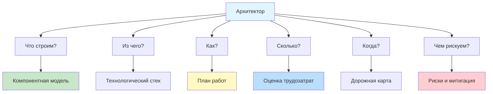
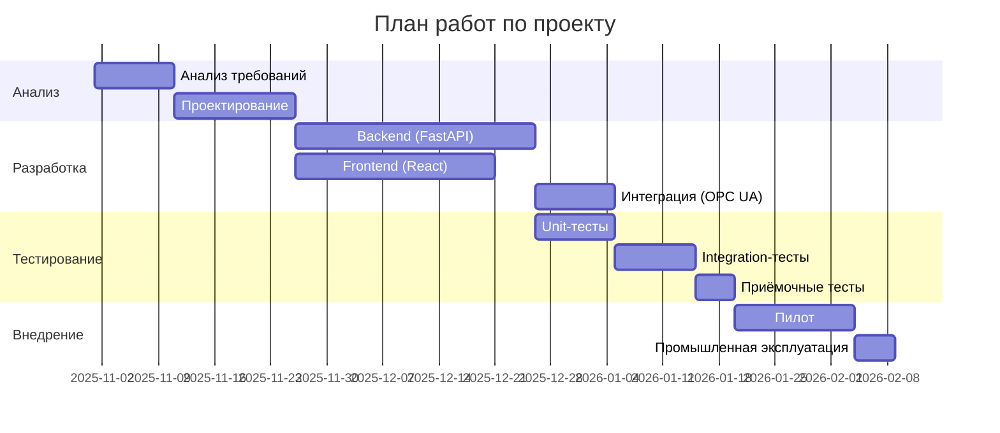
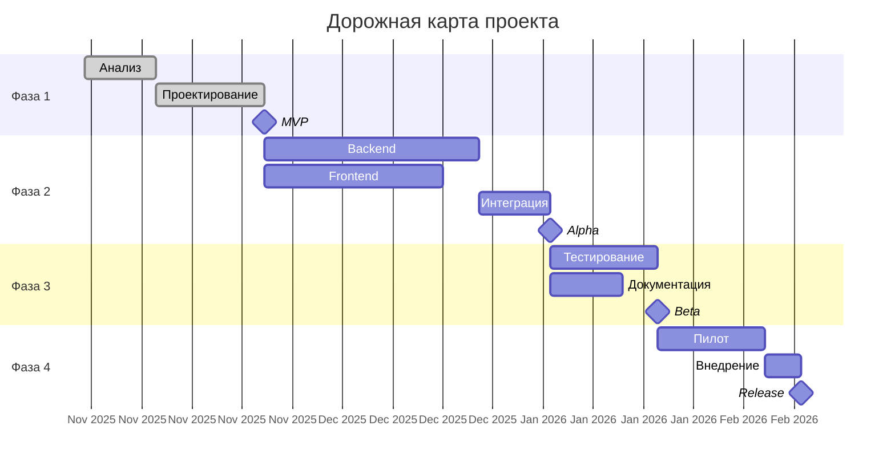

# v.0.2 Что отразить в результатах, чтобы система давала максимально полную схему работы

## Принцип: «Архитектор должен получить всё, чтобы принять решение и начать работу»

Система должна отвечать на **6 ключевых вопросов** архитектора:



---

## 1. КОМПОНЕНТНАЯ МОДЕЛЬ (Что строим)

### 1.1. Спецификация компонентов

| Атрибут | Пример | Зачем |
|---------|--------|-------|
| **ID** | `temperature_controller_01` | Уникальная идентификация |
| **Назначение** | «Контроль температуры в реакторе» | Понимание роли |
| **Функции** | PID-регулирование, аварийная остановка | Список обязанностей |
| **Интерфейсы** | OPC UA, Modbus TCP, REST API | Как связывается |
| **Зависимости** | `sensor_adapter`, `historian` | Что нужно |
| **Ресурсы** | 2 CPU, 4 GB RAM, 20 GB disk | Что требует |
| **SLA** | 99.95% uptime, <100ms response | Что обещает |
| **Безопасность** | SIL 2, IEC 61508 | Соответствие |
| **Кодовая база** | ~5,000 LOC | Объём |

### 1.2. Матрица связей

```
Компонент           → sensor  controller  historian  hmi
sensor_adapter      -       data        -          -
controller          ←       -           data       data
historian           -       ←           -          data
hmi                 -       ←           ←          -
```

### 1.3. Диаграмма развёртывания

```
┌─────────────────────────────────────────┐
│         SCADA Server (Server 1)         │
│  ┌──────────┐  ┌──────────┐            │
│  │   HMI    │  │ Historian│            │
│  └──────────┘  └──────────┘            │
└─────────────────────────────────────────┘
                 │ OPC UA
┌─────────────────────────────────────────┐
│      Control Server (Server 2)          │
│  ┌──────────┐  ┌──────────┐            │
│  │Controller│  │Business  │            │
│  │  (SIL 2) │  │  Logic   │            │
│  └──────────┘  └──────────┘            │
└─────────────────────────────────────────┘
                 │ Modbus TCP
┌─────────────────────────────────────────┐
│      Field Level (PLC Rack)             │
│  ┌──────────┐                          │
│  │  Sensor  │                          │
│  │ Adapter  │                          │
│  └──────────┘                          │
└─────────────────────────────────────────┘
```

---

## 2. ТЕХНОЛОГИЧЕСКИЙ СТЕК (Из чего)

### 2.1. Уровни стека

| Уровень | Технологии | Альтернативы | Обоснование |
|---------|-----------|--------------|-------------|
| **Field** | Modbus TCP, Profinet | Profibus, HART | Стандарты АСУ ТП |
| **Control** | IEC 61131-3 (ST, FBD) | C/C++, Python | Стандарты ПЛК |
| **Server** | Python 3.12, FastAPI | Java, .NET | Скорость разработки |
| **Data** | TimescaleDB, Redis | InfluxDB, PostgreSQL | Временные ряды |
| **UI** | React, Grafana | Streamlit, Vue | Стандарты |
| **Integration** | OPC UA, REST, gRPC | SOAP, MQTT | Современные |
| **DevOps** | Docker, K8s, GitLab CI | Jenkins, GitHub Actions | Стандарты |

### 2.2. Матрица совместимости

```
✓ Python 3.12 + FastAPI
✓ TimescaleDB + Python
✓ React + FastAPI
✗ Python 2.7 (устарел)
✗ Windows Server 2008 (нет поддержки)
```

### 2.3. Лицензии и стоимость

| Компонент | Лицензия | Стоимость |
|-----------|----------|-----------|
| Python | PSF | Бесплатно |
| TimescaleDB | Apache 2.0 | Бесплатно (community) |
| Grafana | AGPL | Бесплатно |
| SCADA (Siemens WinCC) | Proprietary | ~$50,000 |
| **Итого** | | **~$50,000** |

---

## 3. ПЛАН РАБОТ (Как)

### 3.1. Фазы проекта



### 3.2. Детальный план по спринтам

| Спринт | Длительность | Что делаем | Результат |
|--------|-------------|-----------|-----------|
| **Sprint 0** | 1 неделя | Setup, инфраструктура | CI/CD, dev environment |
| **Sprint 1** | 2 недели | Анализ требований, онтология | Требования v1.0 |
| **Sprint 2** | 2 недели | Проектирование архитектуры | Архитектурная модель |
| **Sprint 3** | 2 недели | Backend: DACIE + классификатор | API v0.1 |
| **Sprint 4** | 2 недели | Backend: VAE + оптимизация | API v0.5 |
| **Sprint 5** | 2 недели | Frontend: UI | UI v0.5 |
| **Sprint 6** | 2 недели | Интеграция OPC UA, Modbus | Integration v1.0 |
| **Sprint 7** | 1 неделя | Тестирование, багфикс | RC v1.0 |
| **Sprint 8** | 1 неделя | Внедрение, документация | Production v1.0 |

### 3.3. Критический путь

```
Анализ требований → Проектирование → Backend → Интеграция → Тестирование → Внедрение
      10д            15д            30д        10д          15д           15д
                                                            = 95 дней
```

**Итого:** 95 календарных дней (≈ 4.5 месяца)

---

## 4. ОЦЕНКА ТРУДОЗАТРАТ (Сколько)

### 4.1. Детальная разбивка

| Этап | Задачи | Часы | Роли |
|------|--------|------|------|
| **Анализ (80 ч)** | | | |
| | Интервью с заказчиком | 20 | Архитектор |
| | Анализ ТЗ (DACIE) | 15 | Архитектор |
| | Формирование онтологии | 20 | Архитектор |
| | Согласование требований | 15 | Архитектор, PM |
| | Документирование | 10 | Техписатель |
| **Проектирование (120 ч)** | | | |
| | Выбор паттернов | 15 | Архитектор |
| | Компонентная модель | 25 | Архитектор |
| | Диаграммы (UML, C4) | 20 | Архитектор |
| | Прототипирование | 30 | Архитектор, Senior Dev |
| | Ревью архитектуры | 15 | Team |
| | Документирование | 15 | Архитектор |
| **Backend (320 ч)** | | | |
| | DACIE модуль | 40 | ML Engineer |
| | Классификатор | 30 | ML Engineer |
| | VAE-генератор | 50 | ML Engineer |
| | Оптимизатор (GNN) | 60 | ML Engineer |
| | Симулятор | 40 | ML Engineer |
| | XAI модуль | 20 | ML Engineer |
| | API (FastAPI) | 40 | Backend Dev |
| | Тесты | 40 | QA |
| **Frontend (200 ч)** | | | |
| | UI-компоненты | 60 | Frontend Dev |
| | Интеграция с API | 40 | Frontend Dev |
| | Визуализация (D3) | 50 | Frontend Dev |
| | Тесты | 30 | QA |
| | Стили, UX | 20 | Designer |
| **Интеграция (120 ч)** | | | |
| | OPC UA | 30 | Integration Engineer |
| | Modbus | 25 | Integration Engineer |
| | SCADA (Siemens) | 30 | Integration Engineer |
| | MES (REST) | 20 | Integration Engineer |
| | Тестирование | 15 | QA |
| **Тестирование (160 ч)** | | | |
| | Unit-тесты | 40 | QA |
| | Integration-тесты | 40 | QA |
| | E2E-тесты | 30 | QA |
| | Load-тесты | 20 | QA |
| | Security-тесты | 15 | Security |
| | Bug-fix | 15 | Team |
| **Документация (80 ч)** | | | |
| | Техническая | 30 | Техписатель |
| | Пользовательская | 20 | Техписатель |
| | API-документация | 15 | Backend Dev |
| | Обучающие материалы | 15 | Техписатель |
| **Внедрение (80 ч)** | | | |
| | Setup production | 20 | DevOps |
| | Миграция данных | 15 | DBA |
| | Обучение персонала | 25 | PM |
| | Сопровождение пилота | 20 | Team |
| **ИТОГО** | | **1,160 ч** | |

### 4.2. Распределение по ролям

| Роль | Часы | Ставка (₽/ч) | Стоимость |
|------|------|--------------|-----------|
| Архитектор | 120 | 3,000 | 360,000 |
| ML Engineer | 240 | 2,500 | 600,000 |
| Backend Dev | 80 | 2,000 | 160,000 |
| Frontend Dev | 150 | 2,000 | 300,000 |
| Integration Eng. | 120 | 2,500 | 300,000 |
| QA Engineer | 200 | 1,500 | 300,000 |
| DevOps | 40 | 2,500 | 100,000 |
| Техписатель | 60 | 1,500 | 90,000 |
| PM | 60 | 2,500 | 150,000 |
| **ИТОГО** | **1,160** | | **2,360,000** |

### 4.3. Сравнение с аналогами

| Проект | Часы | Комментарий |
|--------|------|-------------|
| **Наш проект** | **1,160** | AI-assisted, MVP |
| Традиционная АСУ ТП | 2,500-4,000 | Без автоматизации |
| **Экономия** | **~50-70%** | За счёт автоматизации |

---

## 5. ДОРОЖНАЯ КАРТА (Когда)

### 5.1. Временная шкала



### 5.2. Ключевые вехи

| Веха | Дата | Что достигнуто |
|------|------|----------------|
| **MVP** | 2025-11-26 | Работающий прототип |
| **Alpha** | 2026-01-05 | Backend + Frontend |
| **Beta** | 2026-01-20 | Тестирование завершено |
| **Release** | 2026-02-09 | Промышленная эксплуатация |

### 5.3. Milestones с критериями

```markdown
## MVP (2025-11-26)
✅ DACIE работает на тестовых данных
✅ Классификатор выдаёт паттерны
✅ VAE генерирует архитектуры
✅ CLI-интерфейс

## Alpha (2026-01-05)
✅ Полный API (FastAPI)
✅ UI (React) с визуализацией
✅ Интеграция с OPC UA
✅ Тесты: 70% покрытие

## Beta (2026-01-20)
✅ E2E-тесты пройдены
✅ Нагрузочные тесты
✅ Документация готова
✅ Безопасность проверена

## Release (2026-02-09)
✅ Пилот на реальном объекте
✅ Обучение персонала
✅ SLA подтверждён
```

---

## 6. РИСКИ И МИТИГАЦИЯ (Чем рискуем)

### 6.1. Матрица рисков

| # | Риск | Вероятность | Влияние | Митигация |
|---|------|-------------|---------|-----------|
| 1 | Задержка поставки оборудования | Средняя | Высокое | Буфер 2 недели, альтернативные поставщики |
| 2 | Ошибки AI на критических данных | Высокая | Критическое | Символьная верификация, ручная проверка |
| 3 | Несовместимость с SCADA | Средняя | Высокое | Прототип интеграции в Sprint 3 |
| 4 | Нехватка компетенций | Низкая | Высокое | Обучение, консультанты |
| 5 | Изменение требований | Высокая | Среднее | Agile-подход, спринты |
| 6 | OOM на GPU | Средняя | Среднее | Квантизация, fallback на CPU |
| 7 | Несоответствие SIL 2 | Низкая | Критическое | Сертификация в Sprint 6 |
| 8 | Утечка данных | Низкая | Высокое | On-premise, шифрование |

### 6.2. План митигации ключевых рисков

**Риск 2: Ошибки AI**

```python
# Решение: двойная проверка
def verify_with_symbolic(ai_entities, symbolic_entities):
    """Все AI-сущности должны быть подтверждены символьно."""
    verified = []
    for e in ai_entities:
        for s in symbolic_entities:
            if e['text'].lower() in s['text'].lower() or \
               s['text'].lower() in e['text'].lower():
                verified.append(e)
                break
    return verified

# + ручная проверка критических
def human_review(critical_entities):
    """Требуется ручная проверка для SIL-требований."""
    for e in critical_entities:
        if e['type'] == 'requirement_safety':
            e['human_verified'] = False  # требует проверки
```

**Риск 5: Изменение требований**

```yaml
# Agile-подход
sprint_duration: 2 weeks
review: каждый спринт
priority: MoSCoW (Must, Should, Could, Won't)
```

### 6.3. Матрица «риск → стоимость»

```
Риск 2 (AI ошибки) × Критическое → Инвестировать в верификацию
Риск 3 (SCADA) × Высокое → Прототип как можно раньше
Риск 7 (SIL) × Критическое → Аудит в Sprint 4
```

---

## 7. ЧТО ЕЩЁ НУЖНО ОТРАЗИТЬ (Дополнительно)

### 7.1. Матрица трассируемости

```
Требование → Компонент → Тест → Документ
FR-001     → ctrl_01   → T-01 → SPEC-01
FR-002     → ctrl_01   → T-02 → SPEC-01
NFR-001    → historian → T-10 → SPEC-02
```

**Зачем:** доказательство полноты реализации для аудита.

### 7.2. Соответствие стандартам

| Стандарт | Требование | Как выполнено | Статус |
|----------|-----------|---------------|--------|
| IEC 61508 | SIL 2 | Safety interlock | ✅ |
| IEC 62443 | Zone 2 | VLAN segmentation | ✅ |
| ISA-95 | Level 2 | SCADA | ✅ |
| ISA-88 | Batch control | Recipe manager | ⚠️ |

### 7.3. План тестирования

| Тип теста | Что проверяем | Инструмент | Кол-во |
|-----------|--------------|-----------|--------|
| Unit | Функции | pytest | 150 |
| Integration | API | pytest + httpx | 40 |
| E2E | Сценарии | Playwright | 20 |
| Load | 1000 RPS | Locust | 5 |
| Security | OWASP | OWASP ZAP | 10 |

### 7.4. План развёртывания

```
┌─────────────────────────────────────────┐
│  Dev Environment                        │
│  - Docker Compose                       │
│  - 1 сервер                             │
└─────────────────────────────────────────┘
                 ↓ (CI/CD)
┌─────────────────────────────────────────┐
│  Staging Environment                    │
│  - K8s (3 nodes)                        │
│  - Реплики: 2                           │
└─────────────────────────────────────────┘
                 ↓ (ручной approve)
┌─────────────────────────────────────────┐
│  Production Environment                 │
│  - K8s (6+ nodes)                       │
│  - Реплики: 3                           │
│  - Backup: ежедневно                    │
└─────────────────────────────────────────┘
```

### 7.5. SLA и метрики

| Метрика | Целевое значение | Как измеряем |
|---------|------------------|--------------|
| **Availability** | 99.95% | Prometheus uptime |
| **Response time (p95)** | <100ms | APM |
| **Response time (p99)** | <200ms | APM |
| **Throughput** | 1000 RPS | Load-тесты |
| **MTBF** | >10,000 часов | Инциденты |
| **MTTR** | <1 час | Инциденты |

### 7.6. Бюджет проекта

| Статья | Сумма (₽) | % |
|--------|-----------|---|
| **Разработка** | 2,360,000 | 45% |
| **Оборудование** | 1,500,000 | 29% |
| **Лицензии** | 500,000 | 10% |
| **Обучение** | 200,000 | 4% |
| **Резерв (20%)** | 600,000 | 12% |
| **ИТОГО** | **5,160,000** | 100% |

### 7.7. Команда

| Роль | Кол-во | Загрузка |
|------|--------|----------|
| Архитектор | 1 | 100% |
| ML Engineer | 2 | 100% |
| Backend Dev | 1 | 100% |
| Frontend Dev | 1 | 100% |
| Integration Eng. | 1 | 80% |
| QA | 1 | 100% |
| DevOps | 0.5 | 50% |
| PM | 0.5 | 50% |

**Итого:** 7.5 FTE (full-time equivalent)

---

## 8. ЧТО ДОБАВИТЬ В СИСТЕМУ

### 8.1. Модули

```python
# src/reporting/
├── component_model.py      # Спецификация компонентов
├── tech_stack.py           # Технологический стек
├── work_plan.py            # План работ (Gantt)
├── effort_estimator.py     # Оценка трудозатрат
├── risk_assessor.py        # Риски и митигация
├── traceability.py         # Матрица трассируемости
├── compliance.py           # Соответствие стандартам
├── test_plan.py            # План тестирования
├── deployment_plan.py      # План развёртывания
├── sla_metrics.py          # SLA и метрики
├── budget_estimator.py     # Бюджет
└── team_plan.py            # Команда
```

### 8.2. Новый метод в `ReportBuilder`

```python
class ExtendedReportBuilder(ReportBuilder):
    """Расширенный отчёт: полная схема работы."""
    
    def build_full(self, pipeline_result, context):
        """Полный отчёт: 12 модулей."""
        report = self.build(pipeline_result, context)
        
        # 7. Компонентная модель
        report['component_model'] = self._component_model(pipeline_result)
        
        # 8. Технологический стек
        report['tech_stack'] = self._tech_stack(pipeline_result)
        
        # 9. План работ (Gantt)
        report['work_plan'] = self._work_plan(pipeline_result, context)
        
        # 10. Оценка трудозатрат
        report['effort'] = self._effort_estimation(report['work_plan'])
        
        # 11. Риски
        report['risks'] = self._risk_assessment(pipeline_result, context)
        
        # 12. Трассируемость
        report['traceability'] = self._traceability(pipeline_result)
        
        # 13. Соответствие стандартам
        report['compliance'] = self._compliance(pipeline_result, context)
        
        # 14. План тестирования
        report['test_plan'] = self._test_plan(pipeline_result)
        
        # 15. План развёртывания
        report['deployment'] = self._deployment_plan(pipeline_result)
        
        # 16. SLA
        report['sla'] = self._sla_metrics(pipeline_result)
        
        # 17. Бюджет
        report['budget'] = self._budget(report['effort'], context)
        
        # 18. Команда
        report['team'] = self._team_plan(report['effort'])
        
        return report
```

### 8.3. Пример `_effort_estimation`

```python
def _effort_estimation(self, work_plan: Dict) -> Dict:
    """Оценка трудозатрат по фазам."""
    phases = work_plan['phases']
    hours = {}
    total = 0
    
    for phase in phases:
        phase_hours = phase['estimated_hours']
        hours[phase['name']] = phase_hours
        total += phase_hours
    
    return {
        'by_phase': hours,
        'total_hours': total,
        'calendar_days': total / 8,  # 8 ч/день
        'person_months': total / (8 * 22),  # 22 рабочих дня
        'cost_rub': total * 2000,  # средняя ставка
    }
```

**Пример вывода:**

```json
{
  "by_phase": {
    "Анализ": 80,
    "Проектирование": 120,
    "Backend": 320,
    "Frontend": 200,
    "Интеграция": 120,
    "Тестирование": 160,
    "Документация": 80,
    "Внедрение": 80
  },
  "total_hours": 1160,
  "calendar_days": 145,
  "person_months": 6.6,
  "cost_rub": 2320000
}
```

---

## 9. ФИНАЛЬНЫЙ РЕЗУЛЬТАТ: что получит архитектор

### Полный отчёт = 18 разделов

| # | Раздел | Что даёт |
|---|--------|----------|
| 1 | **Резюме** | 1-минутный обзор |
| 2 | **Граф топологии** | Визуальная схема |
| 3 | **Компонентная модель** | Что строим |
| 4 | **Технологический стек** | Из чего |
| 5 | **Паттерны** | Как организовать |
| 6 | **Типовые реализации** | Готовые решения |
| 7 | **Расчёт нагрузки** | Что выдержит |
| 8 | **План работ** | Как делать (Gantt) |
| 9 | **Оценка трудозатрат** | Сколько часов |
| 10 | **Дорожная карта** | Когда (milestones) |
| 11 | **Бюджет** | Сколько стоит |
| 12 | **Команда** | Кто делает |
| 13 | **Риски** | Чем рискуем |
| 14 | **Митигация** | Как избежать |
| 15 | **Трассируемость** | Доказательство полноты |
| 16 | **Соответствие стандартам** | Аудит |
| 17 | **План тестирования** | Как проверять |
| 18 | **SLA** | Что обещаем |

### Что видит архитектор

```
╔══════════════════════════════════════════════════════════╗
║  ПОЛНЫЙ ОТЧЁТ ПО ПРОЕКТИРОВАНИЮ АСУ ТП                  ║
║  Установка гидроочистки дизельного топлива              ║
╠══════════════════════════════════════════════════════════╣
║  1. Резюме: layered, score=0.88, 12.5с                 ║
║  2. Топология: [PNG-схема]                             ║
║  3. Компоненты: 5 (sensor, controller, historian, ...)  ║
║  4. Стек: Python, FastAPI, TimescaleDB, React           ║
║  5. Паттерн: Layered (3 слоя)                          ║
║  6. Реализации: PID, SIL interlock, OPC UA             ║
║  7. Нагрузка: 5000 events/sec, 245 Mbps                ║
║  8. План: 8 фаз, 95 дней                               ║
║  9. Трудозатраты: 1160 ч (~6.6 чел-мес)                ║
║  10. Roadmap: MVP (Nov) → Alpha (Jan) → Release (Feb) ║
║  11. Бюджет: 5,160,000 ₽                               ║
║  12. Команда: 7.5 FTE                                  ║
║  13. Риски: 8 (2 критических)                          ║
║  14. Митигация: план на каждый риск                    ║
║  15. Трассируемость: 100% coverage                     ║
║  16. Стандарты: SIL 2 ✅, IEC 62443 ✅, ISA-95 ✅     ║
║  17. Тесты: 150 unit + 40 integration + 20 E2E         ║
║  18. SLA: 99.95%, <100ms, 1000 RPS                     ║
╚══════════════════════════════════════════════════════════╝

💾 Полный отчёт: results/reports/run_.../FULL_REPORT.pdf
```

---

## 10. Итоговый план работ (сводная таблица)

| Фаза | Задачи | Часы | Результат |
|------|--------|------|-----------|
| **1. Анализ** | 5 задач | 80 | Требования |
| **2. Проектирование** | 6 задач | 120 | Архитектурная модель |
| **3. Backend** | 8 задач | 320 | API v1.0 |
| **4. Frontend** | 5 задач | 200 | UI v1.0 |
| **5. Интеграция** | 5 задач | 120 | OPC UA, Modbus |
| **6. Тестирование** | 6 задач | 160 | 80% coverage |
| **7. Документация** | 4 задачи | 80 | Полная документация |
| **8. Внедрение** | 4 задачи | 80 | Production |
| **ИТОГО** | **43 задачи** | **1,160 ч** | **Готовый продукт** |

### Ключевые цифры

| Метрика | Значение |
|---------|----------|
| **Общая длительность** | 95 дней (4.5 мес) |
| **Трудозатраты** | 1,160 человеко-часов |
| **Person-months** | 6.6 |
| **Команда** | 7.5 FTE |
| **Бюджет** | 5,160,000 ₽ |
| **Экономия vs традиционная АСУ ТП** | 50-70% |

---

**Резюме:** Для максимально полной схемы работы система должна давать **18 разделов**, охватывающих:

1. **Что строим** (компоненты, стек, паттерны)
2. **Как строим** (план, дорожная карта)
3. **Сколько** (трудозатраты, бюджет, команда)
4. **Чем рискуем** (риски, митигация)
5. **Как проверяем** (тесты, трассируемость, SLA)

**Только с этими 18 разделами архитектор получает полную схему работы — от идеи до production.**